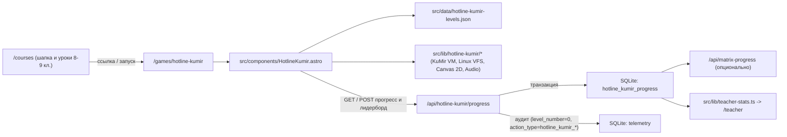

# Аудит сервера и архитектуры School LMS для мини-игры «Hotline KuMir»

> **Назначение документа:** техническое обоснование и архитектурная база (Этап 1) для разработки сюжетной 5-уровневой мини-игры на скоростное программирование на языке **КуМир** (исполнитель Робот) с интегрированным **Linux-терминалом** в стилистике ночного *Hotline Miami*.
> **Контур работы:** изолированное дерево `~/Projects/school-lms-dev-hotline-kumir` (ветка `feat/hotline-kumir`, база `main` коммит `1cf0950`). Боевой каталог `~/Projects/school-lms` не изменяется.

---

## 1. Профиль сервера и клиентских ПК

### 1.1 Фактическая конфигурация продакшн-хоста (`serv-old-alt.school223.net`)

Данные получены непосредственным инспектированием хоста, `/etc/systemd/system/school-lms.service`, `astro.config.mjs`, `package.json`, `telemetry.db` и каталогов сборки `dist/` и `public/static/`:

| Параметр | Фактическое значение | Архитектурное следствие |
|---|---|---|
| **ОС** | ALT Education 11.2 (FalcoVespertinus), Linux x86_64 | Политика без `sudo` (привилегии через `run-as-root` / `su -`), порт `8080` занят `ahttpd` |
| **CPU** | Intel(R) Xeon(R) CPU E3-1220 V2 @ 3.10 GHz (4 ядра, 4 потока, `Thread(s) per core: 1`, 1.6–3.5 GHz) | Node.js запущен в 1 процессе (`Type=simple`), поэтому SSR и синхронный `better-sqlite3` исполняются на 1 потоке |
| **RAM** | 15 GiB всего (использовано ~4.4 GiB, доступно ~10 GiB, Swap 16 GiB не задействован) | Запас памяти большой; текущий процесс `school-lms.service` занимает **106.6 MB** (пик **109.6 MB**, 11 потоков) |
| **Диск** | SSD `sda` 223.6 GB (`SBSSD240-NOV-25S3`, `ROTA=0`, `ext4`, свободно 136 GB) | Высокая скорость случайного чтения/записи для SQLite и статики; съёмный `sdb` (14.6 GB `vfat`) используется только для `agy-portable` |
| **Сеть (узкое место)** | `eth1` — **100 Мбит/с Full Duplex** (`eno1` в `DOWN`), адрес `http://192.168.100.135:3000` | Полезная пропускная способность ~10–11 МБ/с; при одновременном старте **30 учеников** приходится **~3.3 Мбит/с (~340–370 КБ/с) на ПК** |
| **Среда исполнения** | Node.js `v22.23.3`, npm `10.9.9`, Astro `7.3.5`, `@astrojs/node` `11.1.6` | `output: 'server'`, `adapter: node({ mode: 'standalone' })` в `astro.config.mjs` |
| **Systemd-юнит** | `school-lms.service` (`NODE_ENV=production`, `HOST=0.0.0.0`, `PORT=3000`, `Restart=always`, `RestartSec=3`) | Нет внешнего reverse-proxy (Nginx/Caddy) — статику и SSR раздаёт напрямую `dist/server/entry.mjs` |
| **Зависимости проекта** | `tailwindcss` 4.3.3, `@tailwindcss/vite` 4.3.3, `better-sqlite3` 13.0.3, `marked` 18.0.14, `xlsx` 0.18.5 | Встроенный UI-фреймворк клиента для Уровня 3 — локальный `vue.global.js` (583 КБ); для игры возможен чистый Vanilla TS/ESM |
| **База данных** | `telemetry.db` — **62 МБ**, **68 142** записи в `telemetry`, **0** записей в `prince_progress` | `PRAGMA journal_mode = delete`, `synchronous = 2 (FULL)`, `cache_size = -2000` (2 МБ), `busy_timeout = 5000` |

### 1.2 Сравнение веса существующих ассетов платформы

Текущий размер каталога `dist/` составляет **74 МБ**, из них `public/static/` занимает **67 МБ**:

| Модуль / Ассет в `public/static/` и `dist/client/_astro/` | Размер на диске | Время раздачи на 30 ПК по 100 Мбит/с LAN | Вывод для «Hotline KuMir» |
|---|---:|---:|---|
| `luckysheet/` | 29 МБ | > 80 сек при холодном кеше | Неприемлемо для старта урока всем классом |
| `prince/` (`assets` 17 МБ + `lib`/`src` ~1 МБ) | 18 МБ | ~50–55 сек | Допустимо только как отложенная награда, не для синхронного старта класса |
| `pyodide/` | 14 МБ | ~40 сек | Тяжёлый WASM; для КуМир собственный JS/TS-интерпретатор в 100+ раз легче |
| `jodit/` | 4.2 МБ | ~12 сек | — |
| `sql-wasm.wasm` + `sql-wasm.js` | 651 КБ | ~2 сек | — |
| `vue.global.js` | 583 КБ | ~1.7 сек | Можно не грузить, если игра написана на компактном TypeScript + Canvas 2D |
| `bootstrap.min.css` | 228 КБ | ~0.7 сек | В автономном роуте достаточно Tailwind-бандла `Layout.astro` (`Layout.*.css` ≈ 76 КБ) |
| `lms-telemetry.js` | 15 КБ | < 0.05 сек | Эталон легковесного клиентского модуля |
| `courses.astro` JS-бандл (`dist/client/_astro/`) | 68 КБ | < 0.2 сек | Ориентир для клиентского кода новой страницы |

### 1.3 Числовые лимиты для мини-игры «Hotline KuMir»

| Категория | Целевой бюджет | Жёсткий предел | Технические меры обеспечения |
|---|---:|---:|---|
| **Холодная загрузка (HTML + JS + CSS)** | **≤ 250 КБ** | **≤ 500 КБ** | Суммарно ≤ 7.5–15 МБ на 30 ПК (< 1–1.5 сек загрузки). Запрещены MP3/OGG/WAV-файлы и растровые спрайтшиты > 50 КБ |
| **Звук (SFX и синтвейв-пульс)** | **0 КБ внешних файлов** | **≤ 15 КБ кода** | 100% процедурный синтез через **Web Audio API** (осцилляторы, фильтры, шумовые ударные), запуск строго после первого жеста пользователя |
| **Графика (арена Робота, неон, FX)** | **0 КБ внешних картинок** | **≤ 40 КБ кода** | Процедурный рендер на **Canvas 2D** + векторные иконки SVG. Никаких растровых фонов или видео |
| **Клиентские ПК (Intel HD, 1366×768)** | **60 FPS** (активная фаза) | **≥ 30 FPS** | Только 2D Canvas (без WebGL во избежание software fallback), `dpr = Math.min(devicePixelRatio || 1, 1.5)`, логический холст ≤ 720×480 px, `imageSmoothingEnabled = false` |
| **Сложность кадров и GPU** | **≤ 4 мс/кадр** | **≤ 12 мс/кадр** | Запрет per-frame `ctx.filter = 'blur(...)'`, тяжёлого `shadowBlur` и CSS `backdrop-filter`; предрасчёт неоновой сетки/стен в offscreen-буфер. Остановка `requestAnimationFrame` в меню, паузе, брифингах и при `document.hidden === true`, clamp `dt ≤ 50 мс` |
| **Память вкладки браузера** | **≤ 50 МБ** | **≤ 80 МБ** | Ограниченный пул частиц (≤ 120 объектов), кольцевой буфер лога терминала (≤ 250 строк) и трассировки VM КуМир (≤ 5000 шагов) |
| **Нагрузка на SSR (`@astrojs/node`)** | **≤ 1–2 мс** на `GET` страницы | **< 10 мс** | Страница `/games/hotline-kumir` рендерит лёгкую оболочку без запросов к SQLite на этапе SSR; прогресс подтягивается асинхронно после загрузки |
| **Поток записей в SQLite (30 ПК)** | **≤ 1–3 req/s** средний | **≤ 10–15 req/s** пиковый | **Запрещена** отправка запросов на каждую команду терминала, клавишу или шаг Робота. Только опорные точки (старт, завершение миссии, провал/сброс) с батчингом `action_log` (≤ 50 записей, ≤ 8 КБ) |

> [!WARNING]
> **Выявленное узкое место SQLite (`telemetry.db`):**
> В текущей конфигурации `src/pages/api/telemetry.ts` открывает глобальный RW-коннект без включения WAL, поэтому БД работает в `journal_mode = delete` и `synchronous = 2 (FULL)`. Одновременно `src/pages/teacher.astro` опрашивает `GET /api/teacher/stats` каждые **5 секунд** (`setupPolling`), открывая новый `readonly`-коннект на каждый запрос (`progress.ts`, `matrix-progress.ts`, `teacher/stats.ts`). При 30 учениках на этапе реализации рекомендуется включить на RW-инициализации:
> `PRAGMA journal_mode = WAL; PRAGMA synchronous = NORMAL; PRAGMA busy_timeout = 5000;` — это уберёт взаимные блокировки чтения и записи.

---

## 2. Карта точек интеграции в Astro

### 2.1 Авторизация и контекст учащегося

В проекте отсутствует серверная сессия: профиль ученика хранится в `localStorage` (задаётся в `src/pages/index.astro`):
- `student_firstName` — имя ученика;
- `student_lastName` — фамилия ученика;
- `student_class` — класс/slug курса (например, `8-класс`, `9-класс`, `10-класс_углубленный`).

Страница `src/pages/courses.astro` при отсутствии этих трёх ключей выполняет редирект на `/`. Автономный роут мини-игры должен придерживаться того же механизма идентификации (с возможностью безопасного гостевого/демо-просмотра или редиректа/предложения представиться).

### 2.2 Эталонный паттерн интеграции мини-игры (`PrinceEmulator.astro`)

Разбор сквозной кампании Prince of Persia в текущей кодовой базе показывает готовый архитектурный шаблон «изолированная мини-игра + сквозная кампания»:

1. **Конфигурация кампании:** `src/data/prince-campaign.json` (18 этапов: `stage`, `mapLevel`, `title`, `health`, `time`, `skipCutscenes`) и обёртка `src/lib/prince-campaign.ts`.
2. **Изолированная таблица прогресса:** `prince_progress` в `telemetry.db` (`src/lib/prince-progress.ts`, функция `ensurePrinceProgressSchema`) с составными ключами уникальности:
   - `UNIQUE(first_name, last_name, student_class, course_slug, lesson_id)` (правило «1 урок хардкора = 1 этап»);
   - `UNIQUE(first_name, last_name, student_class, stage)`.
3. **UI-компонент:** `src/components/PrinceEmulator.astro` — обёртка над `<iframe>` `/static/prince/index.html` с кнопками «Рестарт» / «На весь экран», keyboard bridge (`keydown` → `iframe.contentWindow`) и слушателем `PRINCE_EVENT` → `TELEMETRY_EVENT`.
4. **Интеграция в оболочку урока:** `src/pages/lesson/[class]/[id].astro` (строки 1213–1286) перехватывает `PRINCE_EVENT` (`action: 'level_complete'`), отправляет `POST /api/telemetry` с `action_type: 'prince_complete'`, `stage_current`, `stage_total`, `map_level`, `mission_name`.
5. **Серверная транзакция:** `src/pages/api/telemetry.ts` (строки 169–358) в транзакции `handlePrinceTx` проверяет `isHardcoreCompleted` (иначе HTTP `403`), правило «1 урок = 1 этап» (HTTP `409` при попытке сдать другой этап на том же уроке, или `200 { idempotent: true }` при повторе), после чего пишет событие в `telemetry` и зачёт в `prince_progress`.
6. **Отображение на дашбордах:**
   - Кабинет ученика `src/pages/courses.astro` + `src/pages/api/matrix-progress.ts`: счётчик `#prince-campaign-counter` (`⚔️ Принц: K / 18 этапов`) и бейджи `⚔️ Эт.N` на карточках уроков.
   - Панель учителя `src/pages/teacher.astro` + `src/lib/teacher-stats.ts`: явная изоляция `isPrinceRow` (строка 592) от расчёта уровней `1..3`, выгрузка из `prince_progress` (строки 892–925), отдельная сортируемая колонка `⚔️ Принц` (`data-sort="prince"`) и секция `#modal-prince-container` в модальной карточке ученика.

### 2.3 Карта интеграции для «Hotline KuMir»



| Слой | Существующие файлы (эталон) | Новые / затрагиваемые модули Hotline KuMir | Назначение |
|---|---|---|---|
| **Роут** | `src/pages/courses.astro` | `src/pages/games/hotline-kumir.astro` | Полноэкранная страница мини-игры на `Layout.astro` (1366×768 без сжатия split-screen) |
| **Компонент** | `src/components/PrinceEmulator.astro` | `src/components/HotlineKumir.astro` | Самодостаточный игровой модуль (`mode: 'standalone' | 'embedded'`, `initialLevel`, `lockedLevel`) |
| **Данные кампании** | `src/data/prince-campaign.json` | `src/data/hotline-kumir-levels.json` | Конфигурация 5 миссий: карта Робота, стены, цели, VFS-узлы Linux, лимит времени, стартовый код КуМир |
| **Движки** | `src/lib/prince-campaign.ts` | `src/lib/hotline-kumir/` (`kumir-vm.ts`, `linux-sandbox.ts`, `arena-renderer.ts`, `synth-audio.ts`, `telemetry-client.ts`) | Типизированные клиентские модули без внешних зависимостей |
| **API** | `src/pages/api/progress.ts`, `src/pages/api/telemetry.ts` | `src/pages/api/hotline-kumir/progress.ts` | `GET`: прогресс ученика по 5 миссиям + школьный Топ-10; `POST`: сохранение результата и аудит-запись |
| **БД (`telemetry.db`)** | `src/lib/prince-progress.ts` | `src/lib/hotline-kumir-progress.ts` | Идемпотентная инициализация таблицы `hotline_kumir_progress` и выборки прогресса |
| **Кабинет `/courses`** | `src/pages/courses.astro` | Индикатор-ссылка в шапке рядом с `⚔️ Принц` | Быстрый вход и счётчик `📼 KuMir: K / 5` |
| **Дашборд `/teacher`** | `src/lib/teacher-stats.ts`, `src/pages/teacher.astro` | Опциональный блок/колонка (Этап интеграции 2) | Просмотр ранга (`S/A/B/C`), лучшего времени и количества пройденных сцен |

### 2.4 Схема хранения прогресса и изоляция от существующих дашбордов

**Критическое наблюдение из кода:**
1. В `src/pages/api/telemetry.ts` (строки 156–164) при `level_number === null` сервер парсит `level_number` из `mission_name` по регулярным выражениям `/Уровень\s*[123]/i`, а `lesson_id` — из `/Урок\s+(\d+)/i`.
2. В `src/lib/prince-progress.ts`, `src/pages/api/matrix-progress.ts` и `src/lib/teacher-stats.ts` события с `action_type = 'level_complete'` (или `'hardcore_reset'`) и `level_number ∈ {1, 2, 3}` напрямую формируют статус урока, разблокировку уровней и право на бонус Prince of Persia.

Чтобы гарантированно не сломать существующие дашборды, расчёт зачётов и контрактные тесты (`tests/telemetry-contract.spec.js`, `tests/teacher-dashboard.spec.js`):

1. **Выделенная таблица `hotline_kumir_progress`:**
```sql
CREATE TABLE IF NOT EXISTS hotline_kumir_progress (
  id INTEGER PRIMARY KEY AUTOINCREMENT,
  first_name TEXT NOT NULL,
  last_name TEXT NOT NULL,
  student_class TEXT NOT NULL,
  level_id INTEGER NOT NULL,               -- 1..5
  mission_slug TEXT NOT NULL,
  best_time_sec INTEGER NOT NULL DEFAULT 0,
  best_score INTEGER NOT NULL DEFAULT 0,
  rank TEXT NOT NULL DEFAULT 'C',          -- 'S' | 'A' | 'B' | 'C'
  code_lines INTEGER DEFAULT 0,
  terminal_cmds_count INTEGER DEFAULT 0,
  attempts_count INTEGER NOT NULL DEFAULT 1,
  source_course_slug TEXT,                 -- опциональная привязка к уроку 8-9 кл.
  source_lesson_id TEXT,
  completed_at DATETIME DEFAULT CURRENT_TIMESTAMP,
  updated_at DATETIME DEFAULT CURRENT_TIMESTAMP,
  UNIQUE(first_name, last_name, student_class, level_id)
);
CREATE INDEX IF NOT EXISTS idx_hotline_kumir_student
  ON hotline_kumir_progress(first_name, last_name, student_class);
```

2. **Изолированные события в таблице `telemetry` (по аналогии со `sprint_complete`):**
   - `course_slug`: `'games'` (если не запущено из конкретного урока);
   - `lesson_id`: `'hotline-kumir'`;
   - `level_number`: **`0`** (передаётся явно, как в `sprint_complete`, что исключает попадание в `lvl_1..3` и `unlockedNormal`/`unlockedHardcore`);
   - `action_type`: `'hotline_kumir_start'`, `'hotline_kumir_complete'`, `'hotline_kumir_fail'` (не пересекаются с `'level_complete'`, `'hardcore_reset'`, `'prince_complete'`, `'sprint_complete'`);
   - `mission_name`: `'Hotline KuMir :: Сцена 1 — ...'` (строго **без** подстрок `Уровень 1..3` и `Урок N`);
   - `stage_current`: `1..5`, `stage_total`: `5`;
   - При доработке `src/lib/teacher-stats.ts` добавить фильтр-охранник `const isHotlineKumirRow = r.course_slug === 'games' || String(r.action_type || '').startsWith('hotline_kumir_');` по аналогии с `isPrinceRow` (строка 592), чтобы попытки мини-игры не попадали в статистику обычных уроков.

---

## 3. Аудит `src/components/Terminal.astro`

Файл `src/components/Terminal.astro` (382 строки) используется как сценарный тренажёр в готовых уроках по ИБ/администрированию. Ниже приведён подробный разбор его возможностей и ограничений для задачи взлома Linux-узлов.

| Подсистема | Что уже есть в `Terminal.astro` | Чего не хватает / выявленные баги и ограничения | Вердикт |
|---|---|---|---|
| **Исполнение сценария** | `phases` с `setup` и `onCommand`, создаваемые через `new Function(...)` (строки 53–54) | Нет типизации, нет общей шины состояния с Canvas 2D и интерпретатором КуМир | Непригодно для связанной 3-панельной игры |
| **Виртуальная ФС (VFS)** | Плоский JS-объект `vfs = { '/': { 'var': { 'log': {} }, 'etc': {}, 'home': {} } }` (строка 60) | • `ls` захардкожен только под `/`, `/var`, `/var/log` (строки 307–313)<br>• `cd` ломается на путях глубже 1 уровня и не нормализует `./` и `../` (строки 314–323)<br>• `getFileContent(args[1])` падает с `TypeError` при вызове `cat` без аргументов (строки 223–224, 325)<br>• Нет прав доступа (`rwx`, `root`/user), скрытых файлов (`.env`, `.ssh`), создания/удаления файлов | Требуется полноценное дерево VFS с правами, симлинками/скрытыми файлами и нормализацией путей |
| **Поиск и фильтрация (`grep`)** | Заглушка `grep [PATTERN] [FILE]` (строки 329–339) | **Баг:** `c2.split('\\n')` ищет литеральные два символа `\n` вместо перевода строки; `new RegExp(args[1], 'g')` не экранирует спецсимволы; нет флагов `-i`, `-r`, `-n` | Переписать на чистом TS с поддержкой флагов и безопасным экранированием |
| **Shell-синтаксис и UX** | Разбор пробелами `cmdLine.split(' ')` (строка 240) | Нет кавычек `"..."`, пайпов (`cat log | grep KEY`), редиректов (`>`, `>>`), связок (`&&`, `;`), истории команд (`↑`/`↓`), автодополнения (`Tab`), флагов (`ls -la`) | Необходимо реализовать легковесный лексер/парсер команд и буфер истории |
| **Симуляция Linux-взлома** | Заглушки `ping`, `ip`, `netstat`, `nmap`, `ssh`, `ps`; мутирующие команды (`rm`, `chmod`, `kill`, `ufw`, `crontab`, `mkdir`, `touch`, `passwd`, `chown`) жёстко печатают ошибку `restricted` (строки 296–306) | Нет живой таблицы процессов (`ps`/`kill PID` не меняет состояние уровня), нет реального сканирования портов (`nmap`) и открытия дверей/отключения турелей на арене, нет `chmod +x`, `find`, `ss`, `curl`/`nc`, запуска скриптов `./exploit.sh` | Нужно единое реактивное состояние уровня, где Linux-команды напрямую меняют мир Canvas-арены и окружение КуМир |
| **Безопасность вывода** | `printLine` пишет через `div.innerHTML` (строки 126, 215) | Пользовательский ввод `cmdText` и паттерн `grep` вставляются в `innerHTML` без HTML-экранирования (локальный XSS в DOM) | Вывод строго через `textContent` / безопасные спаны с экранированием |
| **Изоляция DOM и фокуса** | Жёсткие ID `#terminal-output`, `#cmd-input`, `#prompt-path`; глобальный `document.body.addEventListener('click', ...)` (строка 221); `window.phaseTimer` | Глобальный перехват кликов по `body` будет **отбирать фокус у редактора КуМир и кнопок управления**; захардкожен баннер `Ubuntu 24.04.1 LTS sys-server` | Изолированный компонент без глобальных мутаций `document.body` и `window` |
| **Телеметрия и AFK** | Интеграция с `window.LMSTelemetry.create`, `restartAfterAfk`, `hardcoreReset` | Заточен на `iframe` (`window.parent.postMessage`) и сброс к фазе 0 при любой ошибке | Перенести логику AFK-паузы в автономный адаптер, не ломая `Terminal.astro` |

**Архитектурный вывод:** `Terminal.astro` **нельзя** ни переиспользовать напрямую, ни ломать его контракт (он используется в существующих уроках). Оптимальное решение — создать с нуля чистое ядро **`src/lib/hotline-kumir/linux-sandbox.ts`** без модификации `Terminal.astro`.

---

## 4. Архитектурные ограничения и риски

### 4.1 Матрица обязательных стандартов платформы

1. **Zero-Dependency Policy (`tests/standards-audit.spec.js`, `EXTERNAL_CDN_RE`):**
   - Категорически запрещены любые ссылки на внешние CDN (`cdn.*`, `unpkg.com`, `cdn.jsdelivr.net`, `cdnjs.cloudflare.com`, `fonts.googleapis.com` и др.).
   - Шрифты, стили, иконки и логика обязаны работать на 100% в изолированной школьной LAN без выхода в интернет.

2. **Область действия `tests/standards-audit.spec.js` (`STRICT_STANDARDS_AUDIT=1`):**
   - Автотест сканирует `src/pages/tasks/**/*.astro` и `public/tasks/**/*.html` и проверяет:
     - отсутствие тегов `<style>` и внешних CDN;
     - обязательный `<TaskLayout>`;
     - наличие `TELEMETRY_EVENT` / `LMSTelemetry`, `start_time`, `time_spent_sec`, `stage`/`wave`;
     - для `level3.astro`: наличие экрана `intro` и AFK-защиты;
     - правило `docs/design-level-3.md`: Уровень 3 урока обязан быть **Keyboard-Only (10–20 клавиш: `W/S/A/D`, `Shift`, `Space`, стрелки, `0–9`)**.
   - **Следствие:** текстовый ввод команд Linux и кода на КуМир **несовместим** с требованием «10–20 клавиш без букв» для `level3.astro`. Размещение «Hotline KuMir» на автономном роуте `/games/hotline-kumir` полностью исключает конфликт со строгим аудитом `src/pages/tasks/` и не нарушает `STRICT_STANDARDS_AUDIT=1`.
   - Тем не менее, компонент `HotlineKumir.astro` должен добровольно соблюдать проектный стиль: минимум или отсутствие inline `<style>` (использовать Tailwind CSS / локальный stylesheet) и полный запрет CDN.

3. **Контракт `tests/telemetry-contract.spec.js`:**
   - Проверяет колонки таблицы `telemetry`, индекс `idx_telemetry_sprint`, `POST /api/telemetry`, работу `LMSTelemetry` и отложенный `start_time` в `[id].astro`.
   - Все существующие контракты должны оставаться нетронутыми; таблица `hotline_kumir_progress` добавляется аддитивно (`CREATE TABLE IF NOT EXISTS`).

4. **Визуальные стандарты (`docs/ui-styling.md`) и адаптивность 1366×768:**
   - Строго квадратная геометрия (`rounded-0` / `rounded-none`, запрет `border-radius`).
   - Кибер-палитра с достаточным контрастом (WCAG ≥ 4.5:1 для читаемого текста на `#07070d`; в `TaskLayout.astro` действует `initPlatformContrastGuard`, хотя `<canvas>`, `<svg>`, `<input>` находятся в `SKIP_TAGS`).
   - Регламент анимаций: никаких постоянных тяжёлых фоновых 60 FPS эффектов (матричный дождь и т.п.); только дискретное движение Робота/импульсов и короткие реактивные вспышки (150–350 мс) при взломе/ошибке.

5. **AFK-таймер и корректный учёт времени:**
   - `public/static/lms-telemetry.js` рассчитан на встраивание в `iframe` (`window.parent.postMessage`). В standalone-странице `/games/hotline-kumir` необходим локальный трекер времени с:
     - отложенным стартом (время брифинга/меню не считается, отсчёт идёт после нажатия «НАЧАТЬ МИССИЮ» или первого действия);
     - детектором простоя / AFK (остановка таймера миссии и `requestAnimationFrame` с экраном «ПАУЗА СВЯЗИ — ПРОДОЛЖИТЬ»);
     - защитой от дублирующейся отправки `complete`.

6. **Worktree-дисциплина и особенности `agy-portable` (`vfat` vs `ext4`):**
   - Боевой каталог `~/Projects/school-lms` закрыт для любых правок и тестовых запусков; разработка ведётся только в `~/Projects/school-lms-dev-hotline-kumir` на `ext4`.
   - При запуске команд из `agy-portable` указывать `HOME="/home/SCHOOL223.NET/vatutin_n_a"` для `npm` и `PLAYWRIGHT_BROWSERS_PATH="/home/SCHOOL223.NET/vatutin_n_a/.cache/ms-playwright"` для тестов; dev-сервер поднимать на свободном порту (например, `4322`, так как `3000` занят продом, `4321` зарезервирован под `school-lms-dev`); для локальных E2E-тестов использовать копию `telemetry.db`, а не симлинк.

### 4.2 Реестр технических рисков и меры митигации

| Риск | Вероятность / Влияние | Мера митигации |
|---|---|---|
| Зависание вкладки ученика при бесконечном цикле в КуМир (`нц пока да`) | **Высокая / Критическая** | Пошаговая AST/байткод-VM с жёсткими квотами: `maxSteps ≤ 5000`, `maxLoopIterations ≤ 500`, `maxCallDepth ≤ 32`; **запрет `eval`/`new Function`** |
| Задержка загрузки класса (30 ПК по 100 Мбит/с) из-за тяжёлых медиа | **Средняя / Высокая** | Бюджет бандла ≤ 250 КБ; процедурный Canvas 2D и Web Audio API вместо аудиофайлов и спрайтов |
| Конфликт блокировок SQLite при одновременной сдаче 30 ПК и 5-сек поллинге `/teacher` | **Средняя / Высокая** | Перевод `telemetry.db` в `WAL` + `synchronous=NORMAL` + `busy_timeout=5000`; отправка только контрольных точек |
| Искажение прогресса уроков или ложная разблокировка `prince_progress` | **Высокая при ошибке схемы / Критическая** | Отдельная таблица `hotline_kumir_progress`, `level_number = 0`, выделенные `action_type = 'hotline_kumir_*'`, отсутствие `Уровень 1..3` в `mission_name` |
| Теснота 3-панельного интерфейса в split-screen `iframe` (650×600 px) | **Высокая / Критическая** | Основная точка входа — полноэкранный роут `/games/hotline-kumir` на 100% ширины (1366×768) |
| Потеря фокуса или скролл страницы клавишами в терминале/редакторе | **Средняя / Средняя** | Чёткое разделение фокуса (Терминал / Редактор / Арена), горячие клавиши переключения (`Ctrl+1/2/3` или `F5` запуска), запрет глобального перехвата клика на `document.body` |

---

## 5. Рекомендуемая точка входа и связь с учебным планом

### 5.1 Первичная точка входа: автономный роут `/games/hotline-kumir`

Рекомендуемая архитектура запуска — **полноэкранный роут `src/pages/games/hotline-kumir.astro`** (URL `/games/hotline-kumir`), оборачивающий переиспользуемый компонент `src/components/HotlineKumir.astro`:

- **Почему не `src/pages/tasks/.../level3.astro`:**
  1. На типовом школьном экране `1366×768` внутренний `iframe` в уроке имеет ширину всего `650–680 px`, чего недостаточно для одновременного отображения поля Робота, редактора КуМир и Linux-терминала.
  2. Полноценная работа с кодом КуМир и CLI Linux требует всей клавиатуры, что конфликтует с правилом `Keyboard-Only (10–20 клавиш)` для `level3.astro` и строгим аудитом `STRICT_STANDARDS_AUDIT=1`.
- **Точка обнаружения для учеников:**
  - Кнопка-индикатор в шапке `src/pages/courses.astro` рядом со счётчиком кампании Prince of Persia: `📼 Hotline KuMir: K / 5` → ссылка на `/games/hotline-kumir`.

### 5.2 Привязка 5 сцен кампании к учебному плану 8–9 классов (`src/data/courses.json`)

Анализ `src/data/courses.json` и `src/pages/tasks/` показал, что в **8 классе** сейчас готовы только уроки `№6–10` (системы счисления и логика), а весь блок алгоритмизации и программирования (`№13–34`) свободен. В **9 классе** готовы `№5–8`, `№10`, а блок алгоритмов и ОГЭ (`№15–22`) также свободен. Это позволяет бесшовно связать 5 сцен «Hotline KuMir» с профильными уроками:

| Миссия Hotline KuMir | Механика КуМир + Linux-взлом | Соответствующие уроки в `src/data/courses.json` (свободные слоты) |
|---|---|---|
| **Сцена 1** *(вводная, линейная)* | Линейные алгоритмы Робота (`вверх`, `вниз`, `влево`, `вправо`, `закрасить`) + разведка ФС (`ls`, `cd`, `cat`, `pwd`) | **8 класс №13** «Понятие алгоритма. Исполнители алгоритмов», **№15** «Линейный алгоритм» |
| **Сцена 2** *(датчики и ветвление)* | Датчики (`справа свободно`, `снизу стена` и др.), `если ... то ... иначе ... все` + поиск ключей (`grep`, `find`, скрытые файлы) | **8 класс №16** «Алгоритмическая конструкция «ветвление»», **№26** «Оператор ветвления» |
| **Сцена 3** *(циклы и процессы)* | Циклы `нц N раз` и `нц пока ... кц` + анализ/снятие процессов защиты (`ps`, `kill`, `chmod`) | **8 класс №17** «Алгоритмическая конструкция «повторение»», **№19** «Циклы для формальных исполнителей» |
| **Сцена 4** *(вложенные конструкции, таймер)* | Комбинация циклов и ветвлений, обход динамических патрулей + сетевой взлом (`nmap`, `netstat`, `ssh`, `ufw`) | **8 класс №20** «Циклы и ветвления для формальных исполнителей», **№22** «Контрольная работа» |
| **Сцена 5** *(финал: декомпозиция ОГЭ 15.1)* | Вспомогательные алгоритмы (`алг`), сложный лабиринт с переменными препятствиями + многошаговая эксплуатация Linux-цели | **9 класс №15** «Разбиение задачи на подзадачи. Вспомогательные алгоритмы», **№20** «Контрольная работа», **№22** «Роботизированные системы» |

### 5.3 Режим доступа и опциональная привязка к «Хардкору»

1. **Базовый режим (Фаза 1, основной):** кампания открывается свободно на `/games/hotline-kumir` с последовательной прогрессией `Сцена 1 → Сцена 5` (результат каждой сцены — время, баллы, ранг `S/A/B/C` — пишется в `hotline_kumir_progress`). Это позволяет использовать игру учителем напрямую на уроках 8–9 классов и на школьных турнирах по скоростному программированию.
2. **Опциональная интеграция в уроки и хардкор (Фаза 2):**
   - Из карточек уроков `8 класс №15–20, №22` и `9 класс №15, №20` можно открывать конкретную сцену по параметру `/games/hotline-kumir?level=N&course=8-класс&lesson=19` (передавая `source_course_slug` и `source_lesson_id`).
   - В качестве альтернативной награды за честное прохождение хардкор-режима на уроках 8–9 классов (`isHardcoreCompleted === true`) ученик может получить доступ к бонусному режиму/испытанию `HotlineKumir.astro` в полноэкранном модальном контейнере (по архитектурной аналогии с `PrinceEmulator.astro`), без поломки существующей таблицы `prince_progress`.

---

### Следующий шаг (Этап 2)
На базе зафиксированных лимитов (бандл ≤ 250 КБ, 2D Canvas 30–60 FPS на Intel HD 1366×768, независимое ядро `linux-sandbox.ts`, изолированная таблица `hotline_kumir_progress`) перейти к проектированию геймдизайна 5 уровней, спецификации подмножества языка КуМир и матрицы Linux-команд взлома.
