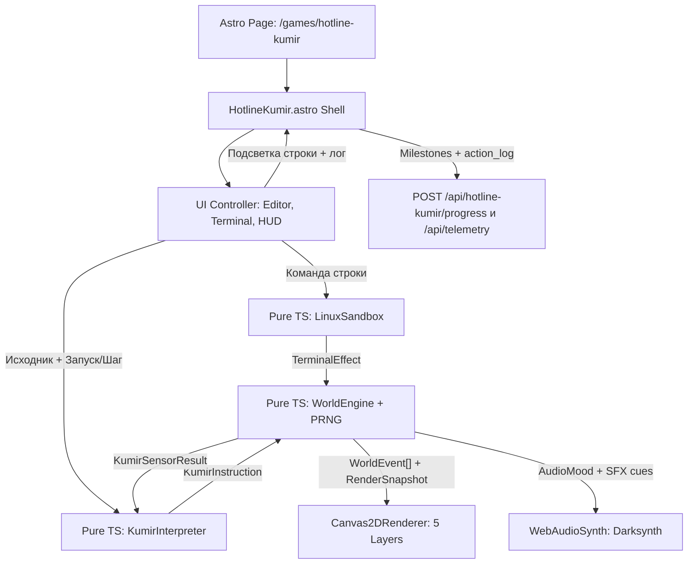
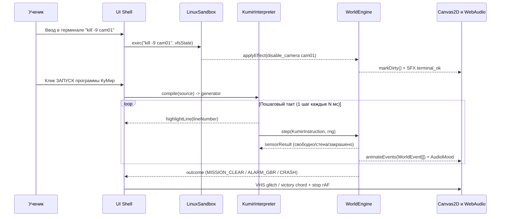

# ADR-001: Выбор игрового рендер-движка, клиентского UI-стека и аудио-архитектуры для «Hotline KuMir»

- **Статус:** Accepted
- **Дата:** 2026-11-25
- **Контекст проекта:** School LMS (Astro 7.3.5 SSR, `@astrojs/node` v11.1.6 `standalone`, ALT Education 11.2), изолированное дерево `school-lms-dev-hotline-kumir` (ветка `feat/hotline-kumir`).
- **Опорные документы:** [01-project-and-server-audit.md](./01-project-and-server-audit.md), [ui-styling.md](../ui-styling.md).

---

## Контекст и ключевые драйверы решения

Из аудита сервера и клиентских рабочих мест (Этап 1) вытекают жёсткие технические ограничения:

1. **Узкое горлышко школьной сети (`100 Мбит/с Full Duplex`):** при одновременном запуске игры классом из 30 учеников полоса составляет ~3.3 Мбит/с (~340–370 КБ/с) на ПК. При этом `@astrojs/node` в режиме `standalone` раздаёт статику из `public/static/` напрямую (без внешнего Nginx/Caddy с on-the-fly Brotli/Gzip для произвольной статики), поэтому критичен **несжатый (raw) вес бандла**. Целевой бюджет холодной загрузки — **≤ 250 КБ** (жёсткий предел — **≤ 500 КБ**).
2. **Интегрированная графика ученических ПК:** Intel HD Graphics 2500/3000/4000, разрешение `1366×768`. WebGL на старых Linux/Windows-драйверах Intel HD нередко падает в программный растеризатор (SwiftShader/llvmpipe) или создаёт расхождения в headless Chromium.
3. **Регламент анимаций `docs/ui-styling.md`:** категорически запрещены непрерывные декоративные циклы `60 FPS` в момент, когда ученик думает и пишет код или вводит команды. Допустимы только событийные эффекты (`150–350 мс`) и физика перемещения дискретных объектов.
4. **Пошаговая природа игры:** игра является **пошаговым тактическим экшеном**, управляемым одновременно командами Linux-терминала (разведка/взлом камер и замков) и программой на языке КуМир (исполнитель Робот). Требуется точная синхронизация шага VM КуМир с подсветкой строки в редакторе, перемещением объектов на карте и детерминированным проигрыванием в тестах.
5. **Политика Zero-Dependency:** запрещены внешние CDN, шрифты и сетевые ассеты; любая библиотека должна жить в `public/static/` или собираться Vite внутри бандла Astro.

### Фактические замеры существующих библиотек в репозитории

| Библиотека в `public/static/` | Версия и лицензия | Raw-размер | Gzip-размер | Время раздачи на 30 ПК (raw) | Замечания по коду |
|---|---|---:|---:|---:|---|
| `prince/lib/phaser.min.js` | Phaser `v2.6.2` (2016, Photon Storm, MIT; в `[id].astro` упоминается как Phaser CE) | **791 364 байт (~773 КБ)** | 185 КБ | ~2.2 сек | ES5 UMD + Pixi v2 + P2 Physics; нет TS-типов; в `src/pages/lesson/[class]/[id].astro` (строка 1534) зафиксирован баг старта канваса в скрытом контейнере |
| `vue.global.js` | Vue `v3.5.43` (MIT) | **596 415 байт (~583 КБ)** | 134 КБ | ~1.7 сек | В `package.json` и `astro.config.mjs` нет `@astrojs/vue`; требует глобального `window.Vue` и отключает строгую compile-time типизацию шаблона без SFC-компилятора |
| `lms-telemetry.js` + бандл Vite | Локальный проект | **~15 КБ** + ~45–60 КБ | ~4 КБ + ~18 КБ | **< 0.25 сек** | Собирается штатным Vite в Astro 7 с tree-shaking |

---

## 1. Сравнительная матрица 5 кандидатов

### Веса критериев оценки (сумма = 100%)

- **К1 (20%) — Совместимость с Astro 7 SSR, Zero-Dependency и вес бандла (холодный старт 30 ПК)**
- **К2 (20%) — Производительность на Intel HD 2500/3000/4000 (`1366×768`) и стоп цикла при простое (`docs/ui-styling.md`)**
- **К3 (20%) — Связка с пошаговым интерпретатором КуМир (`function*` / FSM, подсветка строк, детерминизм)**
- **К4 (15%) — Выразительность ночной стилистики Hotline Miami (неон, конусы, ГБР, маски сверху, FX)**
- **К5 (10%) — Интеграция со звуковым движком (процедурный Web Audio API Darksynth без MP3)**
- **К6 (15%) — Тестируемость в headless Chromium через Playwright (seed, инспекция состояния, 0 флаков)**

### Сводная таблица оценок (шкала 1–5)

| Кандидат | Вес бандла (raw, сверх `Layout.*.css`) | К1 (20%) | К2 (20%) | К3 (20%) | К4 (15%) | К5 (10%) | К6 (15%) | Итог (из 5.00) | Вердикт |
|---|---|---:|---:|---:|---:|---:|---:|---:|---|
| **1. Нативный HTML5 Canvas 2D + Vanilla TS (ES-модули)** | **~45–75 КБ** | **5** | **5** | **5** | **4** | **5** | **5** | **4.85** | **ВЫБРАН** |
| **2. Гибридный SVG/DOM + Vue 3 (`vue.global.js`) + Canvas-оверлей света** | ~610–640 КБ | 2 | 3 | 4 | 3 | 4 | 4 | **3.25** | Отклонён |
| **3. PixiJS v8 или Kaplay/Kaboom.js (локальный бандл)** | ~400–550 КБ | 2 | 3 | 3 | 5 | 3 | 3 | **3.10** | Отклонён |
| **4. Phaser 3 (локальный бандл WebGL + Canvas fallback)** | ~1 200–1 300 КБ | 1 | 3 | 3 | 5 | 4 | 2 | **2.85** | Отклонён |
| **5. Phaser CE / v2.6.2 (`public/static/prince/lib/phaser.min.js`)** | ~773 КБ | 2 | 2 | 2 | 3 | 3 | 2 | **2.25** | Отклонён |

### Детальный разбор кандидатов

1. **Нативный HTML5 Canvas 2D + Vanilla TypeScript (ES-модули):**
   - *Плюсы:* нулевой размер сторонних библиотек; холодная загрузка укладывается в ~120–150 КБ даже с учётом `Layout.*.css` (~76 КБ) и `lms-telemetry.js` (~15 КБ) — вдвое ниже целевого бюджета `≤ 250 КБ`. Полный контроль над жизненным циклом кадра (цикл `requestAnimationFrame` полностью остановлен во время написания кода КуМир и команд Linux). Чистая развязка от DOM и рендера: движок мира работает в Node.js без браузера. Стабильный 2D-контекст в headless Chromium без зависимости от GPU/WebGL.
   - *Минусы:* нет встроенных шейдеров GLSL и готового scene-graph — bloom/глитч/свет нужно написать вручную (решается offscreen-кешированием, градиентами и строчным VHS-срезом примерно за 350–450 строк TS).

2. **Phaser CE / v2.6.2 (`public/static/prince/lib/phaser.min.js`):**
   - *Плюсы:* уже лежит в `public/static/`, не требует новых файлов на диске.
   - *Минусы:* **773 КБ raw** в одном монолите превышают жёсткий предел в 500 КБ; технология 2016 года без TS-типов, с встроенной физикой P2/Arcade, которая в пошаговой клеточной игре не нужна; собственный встроенный `Phaser.RAF` крутит игровой цикл непрерывно (конфликт с запретом 60 FPS простоя в `docs/ui-styling.md`); выявленная нестабильность инициализации при ресайзе/скрытии вёрстки.

3. **Phaser 3 (локальный бандл в `public/static/`):**
   - *Плюсы:* мощная камера (`camera.shake`), пост-процессинг pipeline, tween-менеджер, богатая работа с освещением в WebGL.
   - *Минусы:* даже custom build весит ~1.2–1.3 МБ raw (провал лимита для 30 ПК по 100 Мбит/с LAN); избыточен для клеточной пошаговой арены ~18×12 тайлов; тяжёлый WebGL-контекст на Intel HD 2500/3000 при ресайзах и проблематичное детерминированное тестирование сцены в headless-среде без переработки игрового цикла.

4. **PixiJS / Kaplay (Kaboom.js):**
   - *PixiJS v8 (~480–550 КБ raw):* быстрый WebGL2/WebGPU + Canvas рендерер с фильтрами (Glow/CRT), но добавляет ~0.5 МБ к загрузке, привносит лишний слой DisplayObject-дерева поверх сетки 18×12 и создаёт WebGL-зависимость в headless-тестах; Canvas fallback у PixiJS v8 тяжелее нативного 2D API.
   - *Kaplay / Kaboom.js (~380–450 КБ raw):* ориентирован на rapid-prototyping с глобальным императивным API и собственным `onUpdate`-циклом; слабо стыкуется с чистой функциональной пошаговой VM КуМир и нарушает требование нулевой фоновой нагрузки в фазе редактора.

5. **Гибридный SVG/DOM + Vue 3 (`vue.global.js`) + Canvas-оверлей освещения:**
   - *Плюсы:* текстовый редактор, терминал и кнопки удобно верстать на Vue 3; SVG чётко масштабируется.
   - *Минусы:* подключение локального `vue.global.js` добавляет **583 КБ raw** ещё до кода игры (выход за жёсткий предел 500 КБ); при синхронном перемещении 10–15 объектов, следов, мигалок ГБР, 2D raycast-конусов и VHS-глитча постоянная синхронизация DOM/SVG + отдельного `<canvas>` создаёт рассинхрон координат и лишний `Style/Layout Recalculation` в Chromium. Для 3 панелей UI (редактор + терминал + HUD) достаточно ~250 строк строгого Vanilla TS с точечным обновлением DOM.

---

## 2. Обоснование выбранного стека (Decision)

Принято решение реализовать «Hotline KuMir» на стеке:
- **Рендер арены:** Нативный **HTML5 Canvas 2D** на чистом **TypeScript (strict)** с 5-слойным конвейером и Demand-Driven планировщиком кадров.
- **Клиентский UI (Редактор кода КуМир, Linux-терминал, HUD):** **Vanilla TypeScript + DOM** (использование `Layout.astro` + Tailwind CSS, строгие углы `rounded-0`, Zero-Dependency).
- **Звук и музыка:** Собственный **процедурный синтезатор на Web Audio API** с lookahead-планировщиком ритма и адаптивным кроссфейдом.
- **Сборка:** Штатный Vite-бандлер Astro 7 (автоматическое сжатие, ES-модули, общий бюджет первой загрузки ≤ 150–200 КБ).

### 2.1 Архитектура 5 слоёв рендеринга Canvas 2D и ночной стиль Hotline Miami

Логическое разрешение арены фиксируется на уровне **640×416 px** (или **720×448 px** — сетка до 20×13 тайлов по `32×32 px`), коэффициент плотности пикселей ограничивается `dpr = Math.min(window.devicePixelRatio || 1, 1.5)`, сглаживание отключается (`ctx.imageSmoothingEnabled = false`) для пиксельно-чётких линий на `1366×768`.

| Слой | Назначение и визуальные элементы | Частота перерисовки | Оптимизация для Intel HD |
|---|---|---|---|
| **L0: Static Backdrop Cache** | Ночной асфальт `#0B0618`, неон-сетка `#1B1035`, бетонные стены с контрастной кромкой `#FF007F`/`#00F0FF`, парковочная разметка подъезда ГБР | **1 раз при старте уровня / смене двери** | Рендерится в offscreen-буфер; на кадр тратится один `drawImage` (< 0.2 мс) |
| **L1: Decals & Tile Trail** | Следы ботинок/шин, закрашенные Роботом клетки (Hot Pink `#FF007F` / Electric Cyan `#00F0FF`), разметка кабелей камер, обгоревшие узлы терминалов | Только при добавлении декали | Накопление в отдельный offscreen-слой декалей без перебора истории шагов |
| **L2: Procedural Top-Down Entities** | Робот-агент в маске животного (Петух Ричард / Волк / Тигр — отчётливый силуэт сверху: плечи, голова-овал, яркий гребень/клюв/уши), охранники в тёмных шлемах с вектором взгляда, камеры на стенах, служебный автомобиль ГБР | При изменении состояния / во время шага | Векторные спрайты предкешируются в микро-атласы `48×48 px` на каждый тип сущности с поворотом `ctx.rotate(angle)` |
| **L3: Dynamic 2D Lighting & Cones** | 2D-рейкаст конусов камер видеонаблюдения (учёт стен!), фонари патрулей, жёлтые фары и поочерёдные **красно-синие мигалки ГБР** (`#FF1E42` / `#00A8FF`) | При изменении угла/позиции в шаге или мигании тревоги | Выделенный half-res lightmap-буфер (`320×208 px`) + `globalCompositeOperation = 'lighter'` + `createRadialGradient`. **Полный запрет** `ctx.filter = 'blur(...)'` и per-frame `shadowBlur` |
| **L4: Event-Driven Post-FX** | Полосовой VHS-глитч (3–5 горизонтальных срезов `drawImage` со сдвигом R/B полос), микро-Screen Shake и Screen Tilt (±1.5°) при тревоге, ударе или ошибке КуМир; статичный 1×2 px scanline-паттерн | **Только при `fxTimer > 0` (150–350 мс)** | Не работает в простое; срабатывает строго как реактивный отклик по `docs/ui-styling.md` |

### 2.2 Регламент цикла кадров (Idle-Zero / Demand-Driven Loop)

Для соблюдения запрета фоновых циклов (`docs/ui-styling.md`) и сохранения 0% нагрузки на Intel HD во время обдумывания алгоритма вводится явный конечный автомат планировщика:

- **Фазы `BRIEFING | CODING | TERMINAL | PAUSED | RESULT`:** цикл `requestAnimationFrame` **остановлен (`0 FPS`)**. Одиночная перерисовка выполняется только при наступлении события `markDirty()` (например, ввод команды `cam_off cam-01` в Linux-терминале мгновенно гасит зелёный конус камеры на `L3` за 1 кадр и снова останавливает цикл).
- **Фаза `EXECUTING` или активное окно `fxTimer > 0`:** запускается `rAF` с ограничением шага `dt = Math.min(rawDt, 50)` мс для защиты от скачков при переключении вкладок. Целевое время кадра — **≤ 4 мс**.
- **Потеря видимости вкладки (`document.hidden === true`):** немедленная остановка `rAF` и `AudioContext.suspend()`.

### 2.3 Процедурный аудио-стек (Web Audio API Darksynth / Synthwave)

Вся звуковая подсистема пишется на чистом Web Audio API без единого `.mp3`/`.wav`/`.ogg` файла (экономия ~3–8 МБ трафика класса; объём кода **≤ 15 КБ**):

1. **Инициализация и безопасность класса:** один экземпляр `AudioContext` создаётся и разблокируется через `resume()` строго по первому пользовательскому жесту (клик или клавиша). По умолчанию мастер-громкость умеренная (`0.25`), предусмотрены кнопка `[ЗВУК: ВКЛ/ВЫКЛ]` (горячая клавиша `M` вне полей ввода), сохранение в `localStorage` и флаг URL `?mute=1` для автотестов и тихой работы в кабинете информатики.
2. **Lookahead-секвенсор (без джиттера):** таймер `setInterval` раз в `25 мс` планирует ноты в окно `+100 мс` по аппаратным часам `audioCtx.currentTime`. Это гарантирует ровный синтвейв-грув даже при скачках `rAF` или при `0 FPS` в редакторе кода.
3. **3 динамических музыкальных слоя (`AudioMood`) с плавным кроссфейдом GainNode (`0.4–0.8 с`):**
   - `STEALTH` (**92 BPM**): низкочастотный аналоговый бас (`sawtooth` через `BiquadFilter` lowpass `320 Гц`), редкое минорное арпеджио (`triangle`) и тихий ночной шум города.
   - `ALERT` (**116 BPM**): учащённый октавный бас `1/8`, пульсация сдвоенной полицейской сирены ГБР (частотная модуляция `640 ↔ 880 Гц` на приглушённом gain, чтобы не оглушать класс) и тик таймера приезда наряда.
   - `COMBAT` (**128 BPM**): плотный darksynth — расстроенный дуэт `sawtooth`-баса + синтезированный `kick` (спад частоты `140 → 42 Гц`) + `gated snare` (полосовой белый шум с резким спадом `120 мс`).
4. **Реактивные SFX (`50–300 мс`):** механический щелчок терминала, шаг Робота, неоновый импульс закраски клетки, звук отключения камеры, тревожный удар при столкновении со стеной / обнаружении, победный synth-аккорд.

---

## 3. Архитектурная схема взаимодействия модулей

Ядро симуляции проектируется строго по паттерну **Pure TypeScript Core + Impure Edges**: интерпретатор КуМир, песочница Linux и пошаговое состояние мира не содержат ни одного импорта браузерных API (`window`, `document`, `CanvasRenderingContext2D`, `AudioContext`).

### 3.1 Схема компонентов



### 3.2 Поток одного хода (Последовательность исполнения)



### 3.3 Границы модулей и ключевые TS-контракты (`src/lib/hotline-kumir/`)

```text
src/lib/hotline-kumir/
  types.ts             # Чистые контракты WorldState, WorldEvent, KumirInstruction, AudioMood
  prng.ts              # Детерминированный mulberry32(seed) без Math.random()
  levels.ts            # Конфигурация 5 ночных миссий, стартовый VFS и маршруты ГБР
  kumir-interpreter.ts # Лексер, AST-парсер и корутина (function*) с лимитом шагов
  linux-sandbox.ts     # Виртуальная ФС, конвейеры, права, процессы и эффекты взлома
  world-engine.ts      # Пошаговая симуляция мира: Робот, камеры, патруль, таймер ГБР
  canvas-renderer.ts   # 5-слойный Canvas 2D рендер + Demand-Driven планировщик
  audio-synth.ts       # Web Audio API Darksynth-движок (STEALTH / ALERT / COMBAT)
  test-bridge.ts       # Типизированный read-only мост для E2E Playwright
```

Минимальный набор интерфейсов на стыке слоёв (без привязки к DOM/Canvas):

```ts
export type AudioMood = 'SILENT' | 'STEALTH' | 'ALERT' | 'COMBAT';

export type KumirInstruction =
  | { op: 'MOVE'; dir: 'UP' | 'DOWN' | 'LEFT' | 'RIGHT'; line: number }
  | { op: 'PAINT'; line: number }
  | { op: 'SENSE_CLEAR' | 'SENSE_WALL' | 'SENSE_PAINTED'; dir: 'UP' | 'DOWN' | 'LEFT' | 'RIGHT'; line: number };

export interface WorldEvent {
  type: 'ROBOT_MOVED' | 'TILE_PAINTED' | 'CAMERA_DISABLED' | 'DOOR_OPENED' | 'ALARM_TRIGGERED' | 'WALL_CRASH' | 'MISSION_CLEAR';
  line?: number;
  x?: number;
  y?: number;
  moodAfter: AudioMood;
}
```

---

## 4. Протокол детерминированного headless-тестирования логики отдельно от рендера

Разделение чистого ядра (`kumir-interpreter.ts`, `linux-sandbox.ts`, `world-engine.ts`) и клиентского адаптера (`canvas-renderer.ts`, `audio-synth.ts`) позволяет построить быстрый двухконтурный цикл верификации без внешних зависимостей.

### Контур 1: Чистые модульные тесты логики в Node.js (без браузера)

- **Инструментарий:** встроенный в Node `v22.23.3` раннер `node --test` + нативная поддержка TypeScript type-stripping (подтверждено на хосте; 0 дополнительных npm-зависимостей в `package.json`).
- **Детерминизм времени и случайности:** внутри ядра **запрещены** `Math.random()`, `Date.now()` и `performance.now()`. Любые случайные события (расклад пароля в логах или задержка патруля) порождаются через `mulberry32(seed)`, а время приезда ГБР и фазы патрулей вычисляются от целого счётчика ходов `turnIndex`.
- **Покрываемые сценарии (время прогона ≤ 200 мс):**
  1. Лексический/синтаксический разбор КуМир: точный номер строки ошибки (`line`), корректная обработка циклов `нц пока ... кц`, `нц N раз ... кц`, ветвлений `если ... то ... иначе ... все`.
  2. Предохранитель VM: принудительная остановка при превышении лимита (`MAX_STEPS = 5000`) без зависания потока Node.js.
  3. Сценарии Linux-песочницы: корректное изменение `WorldState` после цепочки команд (`ls` → `cat` / `grep` → `kill` / `chmod` / `nc`) без использования `eval`/`new Function`.
  4. Эталонные (Golden) прохождения и негативные кейсы (врезание в стену, попадание под активную камеру, приезд ГБР) для всех 5 уровней кампании.

### Контур 2: Детерминированные E2E-тесты в headless Chromium (`@playwright/test`)

Поскольку в рендере нет WebGL, а Canvas 2D работает идентично в программном Chromium на Linux и в школьном классе, тесты проходят без графических флаков и таймаут-гонок.

- **Детерминированный режим URL:** открытие страницы `/games/hotline-kumir?seed=1337&fastAnim=1&mute=1`:
  - `seed=1337` фиксирует расклад уровня;
  - `fastAnim=1` сокращает длительность анимации шага с 140 мс до 0–16 мс (или мгновенно завершает текущий переход по вызову `flushAnimations()`);
  - `mute=1` отключает вывод звука, оставляя внутренний `AudioMood` доступным для проверки логики смены музыки.
- **Read-only инспекционный мост `window.__HOTLINE_KUMIR_TEST__`:**
  - `getState()` — сериализованный снимок (`levelId`, `phase`, `turnIndex`, `robotPos`, `activeLine`, `cameras`, `gbrCountdown`, `alarmCount`);
  - `getAudioState()` — текущее настроение (`mood: AudioMood`) и очередь последних SFX-триггеров;
  - `getRenderStats()` — счётчик отрисованных `rAF`-кадров (`rafFrames`), последнее время кадра (`lastFrameMs`) и флаг активности цикла (`isLoopRunning`).
- **Обязательные E2E-инварианты Playwright (на порту `4322` в worktree):**
  1. **Проверка Idle-Zero (`docs/ui-styling.md`):** в фазе `CODING` за 500 мс ожидания `renderStats.rafFrames` не увеличивается (`isLoopRunning === false`).
  2. **Синхронизация подсветки и арены:** ввод эталонной программы КуМир → нажатие «ЗАПУСК» → подтверждение перехода `phase` и конечных координат Робота.
  3. **Интеграция терминала и света:** команда отключения камеры в терминале переводит её состояние в `disabled` в `getState()` и вызывает ровно 1 перерисовку холста.
  4. **Адаптив `1366×768` и контраст:** проверка `boundingBox` без горизонтального скролла (`scrollWidth <= clientWidth`), нулевые ошибки консоли и прохождение `STRICT_STANDARDS_AUDIT=1 npx playwright test tests/standards-audit.spec.js`.
  5. **Изоляция телеметрии:** проверка записи в `hotline_kumir_progress` и `telemetry` с `course_slug = 'games'`, `lesson_id = 'hotline-kumir'`, `level_number = 0` без искажения статистики классов 7–11 на `/teacher`.

---

## Следующий шаг (Этап 3)

На базе выбранного стека (**Canvas 2D + Vanilla TS + Web Audio Darksynth + Pure TS Core**) на Этапе 3 необходимо спроектировать:
- сюжет и геймдизайн всех 5 ночных сцен кампании «Hotline KuMir» (карта масок, патрули, камеры, таймер ГБР);
- точную грамматику поддерживаемого подмножества языка КуМир (исполнитель Робот);
- матрицу Linux-команд взлома и сценарии взаимодействия терминала с 2D-ареной для каждой миссии.
