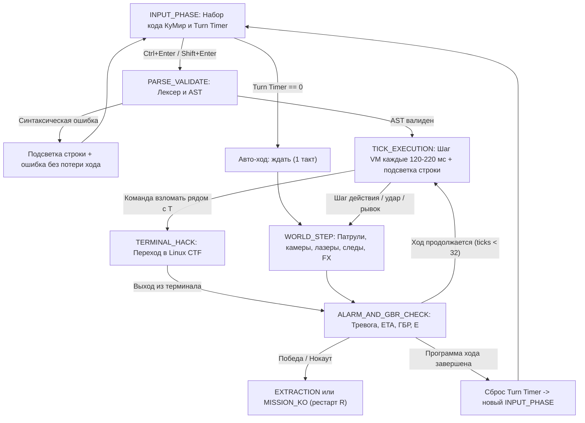

# Спецификация исполнителя «Робот» и языка «КуМир: Hotline Night»

- **Статус:** Draft for Implementation (Этап 3)
- **Дата:** 2026-11-25
- **Методическая база:** УМК К.Ю. Полякова и Е.А. Ерёмина (8–9 классы, базовая программа ФГОС ООО), задание **ОГЭ 15.1**, стандарт [curriculum.md](../curriculum.md).
- **Архитектурная база:** [01-project-and-server-audit.md](./01-project-and-server-audit.md), [02-engine-research-adr.md](./02-engine-research-adr.md), [04-game-design-5-levels.md](./04-game-design-5-levels.md).

---

## 1. Полная грамматика EBNF языка «КуМир: Hotline Night»

Язык «КуМир: Hotline Night» является **строгим надмножеством** школьного подмножества КуМир (исполнитель Робот). Любая валидная программа из задачника ОГЭ 15.1 исполняется без изменений; игровые тактические команды и сенсоры добавлены в виде ортогональных расширений, гармонизированных со сценариями из [04-game-design-5-levels.md](./04-game-design-5-levels.md).

### 1.1 Лексические правила и два режима записи

1. **Регистронезависимость ключевых слов и нормализация `ё → е`:** лексер приводит все ключевые слова и команды к нижнему регистру и заменяет `ё` на `е` (`всё` эквивалентно `все`, `оглушён` эквивалентно `оглушен`).
2. **Комментарии:** `| ...` (вертикальная черта в стиле КуМир) игнорируется до конца строки.
3. **Разделители инструкций:** перевод строки (`NEWLINE`) или точка с запятой (`;`). Пустые строки допускаются везде.
4. **Два допустимых режима оформления:**
   - **Классический (полный) режим (ОГЭ 15.1):** опциональный заголовок `использовать Робот`, главный алгоритм `алг [имя] нач ... кон` и любые вспомогательные процедуры `алг <имя> нач ... кон`.
   - **Скоростной режим (Speed-Coding):** ученик может ввести голую последовательность команд, циклов и условий без шапки `алг / нач / кон` — парсер автоматически оборачивает её в синтетический корневой блок `алг Ход нач ... кон`. Это сокращает рутинный набор на 3 строки при жёстком таймере хода, но в Уровне 5 и режиме обучения декомпозиции поддерживается и поощряется полный синтаксис с `алг`.
5. **Направление по умолчанию:** у расширенных направленных команд (`рывок`, `выбить дверь`, `открыть`, `отключить`, `удар`, `оглушить`, `бросить`, `добить`) аргумент `<направление>` является **опциональным**. Если он не указан, используется текущее направление взгляда Робота (`facing`), заданное последним движением (`вверх | вниз | влево | вправо`).

### 1.2 Формальная грамматика EBNF

```ebnf
program         ::= { sep } [ "использовать" "робот" sep+ ]
                    ( alg_list | speed_block ) { sep } EOF ;

alg_list        ::= alg_decl { sep+ alg_decl } ;

alg_decl        ::= "алг" [ IDENT ] { sep }
                    "нач" sep+ stmt_list "кон" ;

speed_block     ::= stmt_list ;

stmt_list       ::= stmt { sep+ stmt } [ sep+ ] ;

stmt            ::= basic_cmd
                  | action_cmd
                  | if_stmt
                  | loop_while_stmt
                  | loop_times_stmt
                  | call_stmt ;

(* 1. Базовое ядро ОГЭ 15.1 *)
basic_cmd       ::= "вверх"
                  | "вниз"
                  | "влево"
                  | "вправо"
                  | "закрасить" ;

(* 2. Стелс, интеракция и бой — с официальными алиасами из GDD 04 *)
action_cmd      ::= "ждать"
                  | ( "присесть" | "в" "укрытие" | "укрыться" )
                  | ( "взломать" | "подключиться" )
                  | ( "выбить" "дверь" | "открыть" ) [ direction ]
                  | "отключить" [ direction ]
                  | "рывок" [ direction ]
                  | ( "удар" | "оглушить" ) [ direction ]
                  | "бросить" [ direction ]
                  | "добить" [ direction ] ;

direction       ::= "вверх" | "вниз" | "влево" | "вправо" ;

(* 3. Управляющие конструкции КуМир *)
if_stmt         ::= "если" bool_expr "то" sep+ stmt_list
                    [ "иначе" sep+ stmt_list ]
                    "все" ;

loop_while_stmt ::= "нц" "пока" bool_expr sep+ stmt_list "кц" ;

loop_times_stmt ::= "нц" INT_LIT "раз" sep+ stmt_list "кц" ;
                    (* INT_LIT — целое число от 1 до 99 *)

call_stmt       ::= IDENT ;
                    (* Вызов пользовательского вспомогательного алг *)

(* 4. Логические выражения с точным приоритетом КуМир: () > не > и > или *)
bool_expr       ::= or_expr ;
or_expr         ::= and_expr { "или" and_expr } ;
and_expr        ::= not_expr { "и" not_expr } ;
not_expr        ::= [ "не" ] primary_cond ;

primary_cond    ::= "(" bool_expr ")"
                  | sensor_pred ;

(* 5. Датчики (ОГЭ 15.1 + тактические сенсоры) *)
sensor_pred     ::= sensor_dir ( "свободно" | "стена" )
                  | "клетка" ( "закрашена" | "чистая" )
                  | sensor_dir ( "опасно" | "враг" | "дверь" )
                  | "впереди" "опасно"
                  | "рядом" "враг"
                  | "дверь" "закрыта"
                  | ( "рядом" "терминал" | "терминал" "рядом" )
                  | "тревога"
                  | "гбр" "в" "здании"
                  | "враг" "оглушен"
                  | "рывок" "готов" ;

sensor_dir      ::= "сверху" | "снизу" | "слева" | "справа" ;

sep             ::= NEWLINE | ";" ;
```

---

## 2. Матрица команд, датчиков, привязки к ОГЭ 15.1 и модификаторов масок

### 2.1 Таблица команд и управляющих конструкций

| Конструкция / Команда (и алиасы) | Категория | Тики (`tick`) | Эффект в `WorldEngine` | Связь с УМК К.Ю. Полякова (`courses.json`) и ОГЭ 15.1 |
|---|---|---:|---|---|
| `использовать Робот`, `алг`, `нач`, `кон` | Каркас программы | 0 | Оформление главного и вспомогательных алгоритмов (`алг <имя>`) | 8 кл. №13, **9 кл. №15** «Вспомогательные алгоритмы», стандарт ОГЭ 15.1 |
| `вверх`, `вниз`, `влево`, `вправо` | Движение (база) | 1 | Шаг на 1 клетку, обновляет `facing`; стена/закрытая дверь → `WALL_CRASH` (+1 шум, стоп хода) | 8 кл. №13, №15 «Линейный алгоритм», ОГЭ 15.1 |
| `закрасить` | Маркировка (база) | 1 | Активирует/помечает ЭМИ-реле `*` под Роботом | 8 кл. №15, **ОГЭ 15.1** (обработка клеток поля) |
| `если ... то ... [иначе ...] все` | Ветвление (база) | 0 (на проверку) | Ветвление по логическому условию; вложенность поддерживается | **8 кл. №16, №26** «Оператор ветвления», ОГЭ 15.1 |
| `нц <N> раз ... кц`, `нц пока ... кц` | Циклы (база) | 0 (на заголовок) | Повторение блока до `N` раз или по истинности условия | **8 кл. №17, №19, №20**, ОГЭ 15.1 |
| `ждать` | Стелс (такт) | 1 | Пропуск 1 такта на месте; сдвигает цикл камер, лазеров и патрулей | Синхронизация с динамическим окружением |
| `присесть` (`в укрытие`, `укрыться`) | Стелс (защита) | 1 | Скрывает Робота за соседней стойкой `C`/стеной до следующего перемещения | Моделирование скрытого состояния автомата |
| `взломать` (`подключиться`) | Интеракция | 1 (пауза в терминал) | Если `терминал рядом` — открывает изолированную Linux-песочницу для `T`; иначе `E_RT_NO_TERMINAL` | Интеграция алгоритмизации и практического администрирования Linux |
| `отключить [<напр>]` | Стелс / диверсия | 1 | Отключает соседний щиток лазера или камеру на `3` такта (без необходимости открывать терминал) | Управление состоянием устройств по условию |
| `выбить дверь [<напр>]` (`открыть [<напр>]`) | Прорыв | 1 | Взламывает/вышибает соседнюю дверь `D`; при закрытой двери создаёт шум (поднимает `ALERT_DISPATCH` в стелсе) и оглушает врага прямо за дверью | Аварийное ветвление (`если дверь закрыта то`) |
| `рывок [<напр>]` | Скорость / уклонение | 1 | Перемещение на **2 клетки** через конус камеры или линию огня; перезарядка **2 хода** | Расчёт границы поля и комбинация с условием `рывок готов` |
| `удар [<напр>]` (`оглушить [<напр>]`) | Бой (этичный) | 1 | Контактный ЭМИ-разряд по врагу на соседней клетке (оглушает «Пса» и «Кабана»; против щита «Медведя» требует предварительного `бросить`) | Тактическая реакция на `рядом враг` |
| `бросить [<напр>]` | Тактический манёвр | 1 | Бросает ЭМИ-маячок на дальность 2–3 клетки: отвлекает взгляд патруля на 2 такта либо сбивает силовой щит «Медведя» | Отвлечение и подготовка последовательности |
| `добить [<напр>]` | Фиксация (без крови) | 1 | Переводит уже оглушённого врага на соседней клетке в постоянный статус `OFFLINE` (неоновый разряд, враг не очнётся до конца уровня) | Работа со статусами (`если враг оглушен то`) |

### 2.2 Таблица датчиков (сенсоров)

| Датчик и алиасы | Возвращает `true`, когда... | Уровень/назначение |
|---|---|---|
| `сверху/снизу/слева/справа свободно` | Соседняя клетка в заданном направлении не является стеной `#`, укрытием `C` и закрытой дверью `D` | **ОГЭ 15.1 (100% классика)** |
| `сверху/снизу/слева/справа стена` | В соседней клетке стена `#` или непроходимый барьер/закрытая дверь | **ОГЭ 15.1 (100% классика)** |
| `клетка закрашена` / `клетка чистая` | Текущая клетка под Роботом уже помечена ЭМИ-меткой или чиста | **ОГЭ 15.1 (100% классика)** |
| `сверху/снизу/слева/справа опасно` | Соседняя клетка находится под лучом активной камеры `K`, лазером `=` или в секторе атаки врага | Тактический стелс (Ур. 1–5) |
| `впереди опасно` | Опасность на соседней клетке в сторону текущего взгляда Робота (`facing`) | Скоростной алиас к `<напр> опасно` |
| `сверху/снизу/слева/справа враг` / `рядом враг` | В указанной (или любой из 4 ортогональных для `рядом враг`) клетке есть активный охранник или боец ГБР | Боевые ветвления |
| `сверху/снизу/слева/справа дверь` / `дверь закрыта` | Рядом (или перед Роботом для `дверь закрыта`) расположена запертая электродверь `D` | Ветвления прорыва |
| `рядом терминал` (`терминал рядом`) | На текущей или одной из 4 соседних клеток есть рабочий ПК `T` | Безопасная проверка перед `взломать` |
| `тревога` / `гбр в здании` | Активна фаза `ALERT_DISPATCH` / отряд ГБР уже зашёл через точку `G` | Адаптация маршрута эвакуации |
| `враг оглушен` / `рывок готов` | На соседней клетке есть враг в состоянии оглушения / откат команды `рывок` равен 0 | Боевое комбо и безопасный тайминг |

### 2.3 Маски зверей игрока: тактические модификаторы с законом честности КуМира

| Маска игрока | Разблокировка | Тактический модификатор (в рамках `WorldEngine` и `L3`) | Что НИКОГДА не меняется (Честность КуМира) |
|---|---|---|---|
| **Петух «Ричард»** | Доступна с Уровня 1 | Классический эталонный баланс; подсвечивает последнюю клетку маршрута Робота контрастной линией | Базовые датчики, синтаксис, стоимость тиков = 100% стандарт |
| **Сова «Расмус»** | Завершение Уровня 1 или ранг `A+` | На слое `L3` рисует полупрозрачный **контур-прогноз зоны камер и шага патрулей на +1 такт вперёд** | ОГЭ-датчики `свободно` / `стена` выдают строго текущее состояние |
| **Волк «Тони»** | Завершение Уровня 2 / бейдж `COMBAT` | Оглушение от `удар` и `выбить дверь` длится **+1 такт** дольше, а откат `рывок` снижается с 2 до **1 хода** | Логика парсера, лимиты `MAX_TICKS_PER_TURN` и правила стелса идентичны |
| **Лиса / Кот «Спринт»** | Завершение Уровня 3 / бейдж `GHOST` | Стартовый счётчик `ETA` ГБР при тревоге увеличивается на **+1 ход / +15 с**, допустим +1 тихий сбой (`IDS 4` вместо `3`) | При попадании под камеру всё равно честная тревога `ALERT_DISPATCH` |

---

## 3. Пошаговый цикл экшена со счётчиком времени на ход (Speed-Coding Turn Loop)

Ключевая идея «Hotline KuMir»: игра остаётся в состоянии полного ожидания во время обдумывания (`Idle-Zero` — `rAF` выключен), но внешний **счётчик времени хода (`Turn Timer`)** создаёт ощутимое напряжение ночного налёта. Чем грамотнее ученик применит цикл `нц ... кц` или ветвление `если ... то ... все`, тем больше безопасного пути Робот покроет **за один ход** вместо медленного набора по одной команде.

### 3.1 Диаграмма состояний пошагового цикла



### 3.2 Точные временные правила и согласование режимов таймера

1. **Длительность `Turn Timer` по фазам (согласовано с калибровкой уровней 1–5 из [04-game-design-5-levels.md](./04-game-design-5-levels.md)):**
   - **Стелс (`STEALTH`):** **15–30 с** базового окна для быстрых тактических серий (на Уровнях 1–2 стартовый порог мягко расширен до **32–35 с** по принципу угасающих лесов `S_scaffolding`, снижаясь до **25 с** на Уровне 5 и **15 с** в скоростном хардкор-режиме).
   - **Тревога и бой с ГБР (`ESCAPE_RACE` / `GBR_BREACH_COMBAT`):** сжатие окна хода до **8–15 с** в боевом режиме дуэли 1-на-1 с ГБР (при `17–25 с` для многострочных прорывов на начальных уровнях по порогу [difficulty-curve.md](../difficulty-curve.md)).
2. **Истечение таймера (`turnTimeLeft == 0`):** игра **не убивает игрока внезапно**. Незавершённый черновик в редакторе сохраняется как есть (не пропадает!), а в мир отправляется ровно **1 такт `ждать`**: патрули сдвигаются на 1 шаг, вращающиеся камеры меняют сектор, таймер `ETA` ГБР уменьшается на 1 единицу, после чего таймер хода перезапускается. Ученик чувствует реальное давление времени без потери набранного кода.
3. **Разрешение такта (`TICK_EXECUTION`):** во время проигрывания программы включается `rAF`-анимация (`120–220 мс` на 1 такт по настройке скорости, либо `0–16 мс` при `?fastAnim=1` для автотестов). На каждом такте:
   - в редакторе подсвечивается строка `span.startLine`, исполняемая сейчас в `StepResult`;
   - на `Canvas 2D` интерполируется шаг Робота и обновление патрулей/камер/лазеров;
   - по завершении серии `rAF` снова останавливается в `0 FPS`.
4. **Прямая выгода алгоритмов:** если ученик вводит линейно `вправо` × 1 раз за ход — он тратит 5 таймеров хода на коридор; если пишет `нц пока справа свободно и не впереди опасно; вправо; кц` — проходит весь коридор за **1 входной таймер**, экономя и игровые такты, и время на ранг `S`.

### 3.3 Эргономика скоростного набора кода КуМир

Чтобы школьник 14–16 лет успевал программировать под таймером без фрустрации клавиатуры:
- **Горячие клавиши:** `Ctrl+Enter` / `Shift+Enter` — немедленный запуск кода; `F8` — пошаговая трассировка (1 такт); `Tab` — автоотступ 2 пробела; `Ctrl+/` — закомментировать строку (`| `); `M` (вне текстового поля) — выкл/вкл звук; `R` (после KO или в меню) — быстрый рестарт.
- **Автозакрытие конструкций и сниппеты:** при вводе `нц ` и `Enter` редактор сам добавляет закрывающую строку `кц` с нужным отступом, аналогично `если ... то` → `все` и `алг` → `нач ... кон`. Под редактором размещена компактная линейка кликабельных/hotkey-шаблонов (`[F1: нц пока]`, `[F2: если..то]`, `[F3: рывок]`, `[F4: удар]`) с объёмом опоры, убывающим от Уровня 1 к Уровню 5.
- **Редакторская политика копипасты (честный баланс с [curriculum.md](../curriculum.md)):** внутри редактора **разрешены** `Ctrl+Z`, `Ctrl+Y`, выделение своих строк и сохранение собственных `алг`-шаблонов внутри текущей сессии игры (во вкладке «Мои процедуры»); при этом вставка крупных готовых решений из внешнего буфера обмена (`paste` > 40 символов) на рейтинговом/турнирном прогоне блокируется и фиксируется флагом в локальном аудите.

---

## 4. Спецификация интерфейса интерпретатора (`kumir-interpreter.ts`)

Интерпретатор строится как чистый TypeScript-модуль без единого импорта браузерных API (`window`/`document`) и без `eval`/`new Function`. Конвейер компиляции и исполнения:

`Source (UTF-8) → Lexer → Recursive Descent Parser → AST (ProgramNode) → Generator VM (function* step())`

### 4.1 Таблица жёстких лимитов безопасности (защита от зависаний)

| Лимит | Значение | От чего защищает | Поведение при превышении |
|---|---:|---|---|
| `MAX_SOURCE_LENGTH` | **8 192 байт** | Вставка гигантских текстов, зависание лексера | Ошибка компиляции `E_LEX_TOO_LARGE` |
| `MAX_AST_NODES` | **400 узлов** | Перегрузка памяти браузера и стека парсера | Ошибка компиляции `E_PARSE_AST_LIMIT` |
| `MAX_LOOP_COUNT_ARG` | **99** | `нц 999999 раз` (искусственный флуд ходов) | Ошибка `E_SEM_LOOP_BOUND` |
| `MAX_CALL_DEPTH` | **16 уровней** | Бесконечная взаимная рекурсия `алг А` → `алг А` | Ошибка выполнения `E_RT_STACK_OVERFLOW` |
| `MAX_TICKS_PER_TURN` | **32 такта** | Слишком длинный цикл за один таймерный ход | Штатная пауза `TURN_LIMIT_REACHED`, остаток сбрасывается к следующему вводу |
| `MAX_VM_OPS_PER_TURN` | **512 операций** | Пустой вечный цикл вида `нц пока сверху стена кц` (0 действий, бесконечная проверка условия!) | Мгновенный разрыв `E_RT_INFINITE_LOOP` с указанием строки `нц пока` |
| `MAX_TOTAL_STEPS_SESSION` | **5 000 шагов** | Лимит памяти вкладки из аудита [01-project-and-server-audit.md](./01-project-and-server-audit.md) | Принудительная остановка миссии с защитой памяти |

### 4.2 TypeScript-интерфейсы AST, состояния VM и ошибок

```ts
export type Direction = 'UP' | 'DOWN' | 'LEFT' | 'RIGHT';
export type SensorDirection = Direction | 'FRONT' | 'ANY';

export interface SourceSpan {
  startLine: number;
  startCol: number;
  endLine: number;
  endCol: number;
}

export type ActionCommandKind =
  | 'MOVE'
  | 'PAINT'
  | 'WAIT'
  | 'CROUCH'
  | 'HACK'
  | 'DISABLE'
  | 'BREACH_DOOR'
  | 'DASH'
  | 'STRIKE'
  | 'THROW'
  | 'FINISH';

export type SensorKind =
  | 'IS_CLEAR'
  | 'IS_WALL'
  | 'IS_PAINTED'
  | 'IS_DANGER'
  | 'HAS_ENEMY'
  | 'HAS_DOOR'
  | 'NEAR_TERMINAL'
  | 'IS_ALARM'
  | 'GBR_INSIDE'
  | 'ENEMY_STUNNED'
  | 'DASH_READY';

export type BoolExprNode =
  | { kind: 'BINARY'; op: 'AND' | 'OR'; left: BoolExprNode; right: BoolExprNode; span: SourceSpan }
  | { kind: 'NOT'; operand: BoolExprNode; span: SourceSpan }
  | { kind: 'SENSOR'; sensor: SensorKind; dir?: SensorDirection; negatePainted?: boolean; span: SourceSpan };

export type StmtNode =
  | { kind: 'ACTION'; action: ActionCommandKind; dir?: Direction; span: SourceSpan }
  | { kind: 'IF'; cond: BoolExprNode; thenBranch: StmtNode[]; elseBranch?: StmtNode[]; span: SourceSpan }
  | { kind: 'WHILE'; cond: BoolExprNode; body: StmtNode[]; span: SourceSpan }
  | { kind: 'REPEAT'; count: number; body: StmtNode[]; span: SourceSpan }
  | { kind: 'CALL'; algName: string; span: SourceSpan };

export interface AlgDeclNode {
  name: string;
  body: StmtNode[];
  span: SourceSpan;
}

export interface ProgramNode {
  entryAlg: string;
  algorithms: Record<string, AlgDeclNode>;
  isSpeedWrapped: boolean;
  locCount: number;
  usedLoops: boolean;
  usedConditions: boolean;
  usedSubprograms: boolean;
}

export interface KumirActionRequest {
  action: ActionCommandKind;
  dir?: Direction;
  line: number;
}

export type StepResult =
  | { status: 'YIELD_ACTION'; request: KumirActionRequest; line: number; callStack: string[] }
  | { status: 'COMPLETED'; ticksUsed: number; vmOpsUsed: number }
  | { status: 'PAUSED_TURN_LIMIT'; ticksUsed: number; line: number }
  | { status: 'RUNTIME_ERROR'; error: KumirError; ticksUsed: number };

export type KumirErrorCode =
  | 'E_LEX_TOO_LARGE'
  | 'E_LEX_UNKNOWN_TOKEN'
  | 'E_PARSE_UNEXPECTED_TOKEN'
  | 'E_PARSE_MISSING_END'
  | 'E_PARSE_BAD_EXPRESSION'
  | 'E_PARSE_AST_LIMIT'
  | 'E_SEM_UNKNOWN_ALG'
  | 'E_SEM_DUPLICATE_ALG'
  | 'E_SEM_LOOP_BOUND'
  | 'E_RT_STACK_OVERFLOW'
  | 'E_RT_INFINITE_LOOP'
  | 'E_RT_WALL_CRASH'
  | 'E_RT_NO_TERMINAL'
  | 'E_RT_DASH_COOLDOWN'
  | 'E_RT_NO_TARGET';

export interface KumirError {
  code: KumirErrorCode;
  line: number;
  column: number;
  messageRu: string;
  isFatalToTurn: boolean;
}

export interface KumirSensorReader {
  evalSensor(sensor: SensorKind, dir?: SensorDirection): boolean;
}

export interface KumirVM {
  compile(source: string): { ok: true; program: ProgramNode } | { ok: false; errors: KumirError[] };
  createExecution(program: ProgramNode, sensors: KumirSensorReader): Generator<StepResult, StepResult, void>;
}
```

### 4.3 Коды синтаксических и рантайм-ошибок (понятная диагностика на русском)

| Код ошибки | Фаза | Понятное сообщение для ученика (`messageRu`) | Реакция игры |
|---|---|---|---|
| `E_LEX_UNKNOWN_TOKEN` | Лексер | `Строка N: неизвестная команда «X». Проверьте раскладку или напишите «помощь».` | Подсветка строки, возврат в редактор **без потери хода** |
| `E_PARSE_MISSING_END` | Парсер | `Строка N: цикл «нц» или условие «если» не закрыто словом «кц» / «все».` | Подсветка открывающего блока, возврат в редактор без потери хода |
| `E_PARSE_BAD_EXPRESSION` | Парсер | `Строка N: ожидалось логическое условие (например, «справа свободно» или «не тревога»).` | Подсветка строки, возврат в редактор |
| `E_SEM_UNKNOWN_ALG` | Семантика | `Строка N: алгоритм «Имя» не объявлен. Добавьте блок «алг Имя ... нач ... кон».` | Возврат в редактор |
| `E_SEM_LOOP_BOUND` | Семантика | `Строка N: число повторений в «нц N раз» должно быть целым от 1 до 99.` | Возврат в редактор |
| `E_RT_INFINITE_LOOP` | ВМ (рантайм) | `Строка N: обнаружено зацикливание (превышен лимит 512 проверок без шага). Проверьте условие «нц пока».` | Аварийная остановка серии (VHS-глитч 250 мс), ход завершается |
| `E_RT_STACK_OVERFLOW` | ВМ (рантайм) | `Строка N: превышена глубина вложенности вызовов (16). Возможна бесконечная рекурсия «алг».` | Аварийная остановка серии, ход завершается |
| `E_RT_WALL_CRASH` | `WorldEngine` | `Строка N: Робот упёрся в стену или закрытую дверь. Используйте датчик «свободно» или «выбить дверь».` | Стоп хода, `+1` к шуму IDS, потеря остатка тиков этого хода |
| `E_RT_NO_TERMINAL` | `WorldEngine` | `Строка N: рядом нет ПК «T» для команды «взломать».` | Стоп хода без смерти; подсказка подойти к терминалу |
| `E_RT_DASH_COOLDOWN` | `WorldEngine` | `Строка N: «рывок» ещё перезаряжается. Используйте проверку «если рывок готов то ...».` | Команда пропускается как `ждать` или прерывает цикл с предупреждением |

---

## 5. Эталонные мини-программы на «КуМир: Hotline Night»

Ниже приведены 6 проверенных эталонных паттернов, полностью валидных по EBNF из раздела 1 и готовых для модульных тестов `node --test` и подсказок уровней.

### Паттерн 1. Проход коридора с маркировкой ЭМИ-реле (ОГЭ 15.1 база)

```kumir
| Классическая конструкция ОГЭ 15.1 в скоростном режиме
нц пока справа свободно и не впереди опасно
  если клетка чистая то
    закрасить
  все
  вправо
кц
```

### Паттерн 2. Выжидание окна камеры и рывок сквозь луч

```kumir
| Ожидание безопасного такта цикла камеры K с последующим рывком на 2 клетки
нц пока справа опасно
  ждать
кц
если рывок готов то
  рывок вправо
иначе
  вправо
  вправо
все
```

### Паттерн 3. Уклонение от патруля за стойкой и подключение к Linux-ПК

```kumir
| Подход к стойке C, укрытие на время прохода охранника и взлом ПК T
вправо
присесть
нц пока справа опасно
  ждать
кц
вправо
если рядом терминал то
  взломать
все
```

### Паттерн 4. Аварийный прорыв через закрытую дверь с отключением щитка

```kumir
| Ветвление на закрытой двери D: прорыв, фиксация оглушённого врага и отключение лазера
если справа дверь то
  выбить дверь вправо
все
вправо
если враг оглушен то
  добить справа
все
отключить вверх
```

### Паттерн 5. Тактический бой против отряда ГБР («Пёс» + щитовик «Медведь»)

```kumir
| Разрушение ЭМИ-щита «Медведя» маячком перед контактным оглушением
если справа враг то
  бросить вправо
  оглушить вправо
  добить вправо
иначе
  если сверху свободно то
    рывок вверх
  все
все
```

### Паттерн 6. Полная декомпозиция через вспомогательные алгоритмы (Уровень 5 / ОГЭ 15.1)

```kumir
использовать Робот

алг ГлавныйПрорыв
нач
  ПройтиБезопасно
  НейтрализоватьСектор
  если тревога и сверху свободно то
    рывок вверх
  все
кон

алг ПройтиБезопасно
нач
  нц пока справа свободно и не справа опасно
    вправо
  кц
кон

алг НейтрализоватьСектор
нач
  если рядом враг то
    бросить вправо
    удар вправо
  все
  если рядом терминал то
    взломать
  все
кон
```

---

## Связь с архитектурой Этапов 1–4 и готовность к реализации (Этап 5)

Спецификация полностью замыкает цикл проектирования в `docs/hotline-kumir/`:
1. Аудит сервера и изоляции БД — [01-project-and-server-audit.md](./01-project-and-server-audit.md).
2. Выбор рендера (`Canvas 2D + Vanilla TS + Web Audio Darksynth`) и двухконтурное тестирование — [02-engine-research-adr.md](./02-engine-research-adr.md).
3. Грамматика EBNF и ВМ КуМир с тактическими расширениями — текущий документ `03-kumir-robot-spec.md`.
4. Геймдизайн 5 уровней, Fail-Forward с ГБР и Linux CTF — [04-game-design-5-levels.md](./04-game-design-5-levels.md).

Следующий шаг — **Этап 5 (реализация чистого ядра и прототипа в worktree `~/Projects/school-lms-dev-hotline-kumir`)**: перенос контрактов в `src/lib/hotline-kumir/` (`kumir-interpreter.ts`, `linux-sandbox.ts`, `world-engine.ts`) с покрытием `node --test`.
