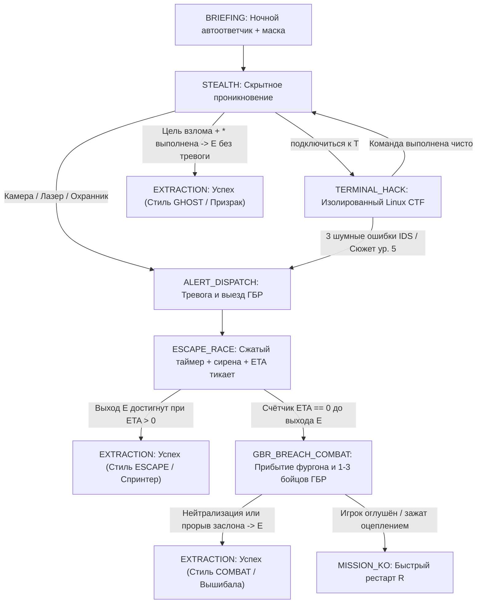

# GDD-001: Геймдизайн кампании «Hotline KuMir» (5 уровней, Fail-Forward с ГБР и CTF-взлом в Linux)

- **Статус:** Draft for Implementation (Этап 4)
- **Дата:** 2026-11-25
- **Целевая аудитория:** учащиеся 8–9 классов (14–16 лет); уроки алгоритмизации, исполнителя Робот и ОГЭ 15.1, а также школьные турниры по скоростному программированию.
- **Опорные документы:** [design-level-3.md](../design-level-3.md), [difficulty-curve.md](../difficulty-curve.md), [01-project-and-server-audit.md](./01-project-and-server-audit.md), [02-engine-research-adr.md](./02-engine-research-adr.md), [03-kumir-robot-spec.md](./03-kumir-robot-spec.md).

---

## 1. Деконструкция референсов и правила школьной адаптации

«Hotline KuMir» объединяет атмосферу ночного неонового боевика с интеллектуальной точностью пошаговой тактики и этичного терминального взлома.

| Референс | Что заимствуется в ядро механики | Как адаптируется под формат школы (14–16 лет) и веб-стека |
|---|---|---|
| **Hotline Miami** | Ночная неоновая палитра (`#FF007F`, `#00F0FF`, `#0B0618`, `#FF1E42`/`#00A8FF`); **звериные маски у ВСЕХ персонажей**; контрастные помещения с видом сверху; короткие напряжённые сцены; резкий Darksynth-пульс и Screen Shake / VHS-глитч (`150–350 мс`); брифинги перед заданием в формате ночного автоответчика/пейджера; мгновенный рестарт `[R]`. | Полный отказ от крови и натуралистичной жестокости: враги нейтрализуются **ЭМИ-шокером / кибер-нокаутом** с неоновыми искрами и индикатором `ZZZ / OFFLINE`, а двери выбиваются электромагнитным тараном. Сюжет подаётся как ночной кибер-аудит и возврат похищенных школьных экзаменационных данных из дата-центров корпорации «НЕОН-СЕКЬЮРИТИ». |
| **Invisible, Inc. / Gunpoint / Ronin** | Честный пошаговый стелс с полным телеграфированием конусов камер, лазеров и вектора патруля до запуска хода; тесная связка взлома электроники (Linux-терминал) с физическим состоянием дверей, камер и лазеров на 2D-карте. | На слое `L3` игрок всегда заранее видит точные границы лучей камер и лазеров, а в режиме `CODING` цикл `rAF` остановлен (`0 FPS` по регламенту [ui-styling.md](../ui-styling.md)). |
| **Crypt of the NecroDancer / Into the Breach / SUPERHOT** | Давление счётчика времени на написание хода (`T_turn`) превращает составление 1–5 строк кода КуМир в динамичный тактический экшен; телеграфирование намерений врагов (`[→ ШАГ]`, `[! РЫВОК]`, `[⚡ ЗАХВАТ]`). | Темп опирается на закон Хика-Хаймана и коэффициент временного давления `TPR = T_required / T_available ∈ [0.55; 0.85]` из [design-level-3.md](../design-level-3.md). Нет внезапных смертей без предупреждения: даже ошибка `WALL_CRASH` не обрывает забег в стелсе, а лишь создаёт шум. |
| **Hacknet / TIS-100 / Shenzhen I/O** | Органичная врезка реального POSIX-терминала в сюжет операции; система поощрения компактности и структурности кода (`LOC ≤ PAR_LOC`, бонус за `нц`, `если`, `алг`). | Изолированная детерминированная VFS в TypeScript (`linux-sandbox.ts`): учебно-этичный CTF без единой сетевой атаки наружу и без `eval`/`new Function`. |

---

## 2. Полная спецификация Fail-Forward механики (Тревога → Выезд ГБР → Побег / Бой)

В «Hotline KuMir» обнаружение камерой, лазером, охранником или системой IDS в терминале **не вызывает мгновенный Game Over**. Вместо фрустрирующего сброса игра переходит в более острую фазу **Fail-Forward** с живой дилеммой: успеть завершить задачу и сбежать до приезда наряда ГБР или вступить с прибывшей группой в тактический прорыв.

### 2.1 Конечный автомат состояния миссии



### 2.2 Визуализация выезда ГБР (HUD + Canvas 2D L3)

1. **Верхняя панель `GBR DISPATCH TRACKER`:** при переходе в `ALERT_DISPATCH` в шапке арены загорается неоновая рация перехвата (`#FF1E42` / `#00A8FF`) и 4-сегментная полоса маршрута фургона: `[БАЗА] → [ПЕРЕКРЁСТОК] → [ДВОР] → [ВХОД G]`. Отображается двойной счётчик: `ГБР ПРИБУДЕТ ЧЕРЕЗ: N ХОДОВ | XX.X С` (двигается как по совершённым сериям ходов, так и по истечении лимита времени на ход).
2. **Световая нарастающая индикация (`L3` Canvas 2D):** с каждым шагом убывания `ETA` у точки входа `G` за стеной нарастает интенсивность красно-синих отблесков мигалок (перерисовка в `EXECUTING` или одиночный импульс по окончании хода без нарушения Idle-Zero).
3. **Аварийный режим помещений:** охранные шлюзы переводятся в тревожный режим (у нехакнутых дверей мигает красный замок, неактивные камеры перезагружаются через 2 хода, если не были убиты командой `kill`/`off` в Linux).
4. **Аудио-динамика:** `STEALTH (92 BPM)` → кроссфейд в `ALERT (116 BPM)` при запуске рации ГБР → кроссфейд в `COMBAT (128 BPM)` в момент сцены высадки фургона.

### 2.3 Ветка А (`ESCAPE_RACE`) и Ветка Б (`GBR_BREACH_COMBAT`)

| Фаза | Условия активации | Правила и изменения геймплея | Условие завершения |
|---|---|---|---|
| **Ветка А: `ESCAPE_RACE`** | Любой триггер тревоги (`CAMERA_SPOTTED`, `LASER_TRIPPED`, `PATROL_LOS`, `TERMINAL_IDS_3X`, либо удаление лога на Уровне 5), пока `ETA > 0`. | Время на подготовку хода `T_turn` сокращается на **25–30%** (режим адреналина, минимум ≥ 17 с по стандарту [difficulty-curve.md](../difficulty-curve.md)). Все ранее взломанные данные сохраняются — можно быстро доделать взлом и бежать на `E`. | Достижение клетки `E` до `ETA == 0` (при выполненной цели взлома и ЭМИ-метки `*`). Награда: бейдж **«Спринтер» (`ESCAPE`)**. |
| **Ветка Б: `GBR_BREACH_COMBAT`** | Счётчик `ETA` дошёл до `0` раньше, чем игрок дошёл до `E`. | У точки `G` появляется фургон ГБР с фарами и красно-синими мигалками. В здание заходят **1–3 бойца ГБР** в звериных масках («Пёс», «Кабан», «Медведь»), блокируя путь к `E`. Выход `E` переходит в статус `ЗАБЛОКИРОВАНО (ГБР)` и открывается, как только боевой заслон нейтрализован или прорван с выходом за линию оцепления. | Нейтрализация или тактический прорыв заслона ГБР + выход на `E`. Награда: бейдж **«Вышибала» (`COMBAT`)**. |

### 2.4 Расширение школьного языка КуМир для стелса и боя (по [03-kumir-robot-spec.md](./03-kumir-robot-spec.md))

Язык «КуМир: Hotline Night» сохраняет стандартный синтаксис 8–9 классов и ОГЭ 15.1 и дополняется тактическими глаголами и датчиками (аргумент `<направление>` опционален — по умолчанию берётся вектор взгляда Робота `facing`):

- **Базовые команды и конструкции (ФГОС / ОГЭ 15.1):** `использовать Робот`, `вверх`, `вниз`, `влево`, `вправо`, `закрасить` (пометка ЭМИ-реле `*`), датчики (`сверху/снизу/слева/справа свободно`, `... стена`, `клетка закрашена`, `клетка чистая`), ветвление `если ... то ... иначе ... все`, циклы `нц N раз ... кц`, `нц пока ... кц`, логические связки `и`, `или`, `не`, вспомогательные алгоритмы `алг ... нач ... кон`.
- **Тактические команды уровня (с официальными алиасами из EBNF):**
  - `ждать` — пропуск 1 такта для синхронизации с циклом камер и патрулей (также автоматически срабатывает при обнулении `Turn Timer`: `turnTimeLeft == 0` выполняет `ждать` на 1 такт без потери набранного в редакторе кода);
  - `взломать` (`подключиться`) — открывает Linux-терминал на текущем или соседнем ПК `T` (в зоне ≤ 1 клетки);
  - `отключить [<направление>]` — временно (на 3 такта) гасит соседний щиток лазера или камеру без входа в терминал;
  - `выбить дверь [<направление>]` (`открыть [<направление>]`) — мгновенно разрушает соседнюю закрытую дверь `D` (поднимает тревогу `ALERT_DISPATCH` в стелсе и оглушает врага за дверью!);
  - `рывок [<направление>]` — быстрый бросок на **2 клетки** через конус камеры или линию огня (перезарядка 2 хода; 1 ход в маске Волка «Тони»);
  - `удар [<направление>]` (`оглушить [<направление>]`) — контактный ЭМИ-импульс по врагу на соседней клетке (нейтрализует «Пса», «Кабана» или сбитого «Медведя»);
  - `добить [<направление>]` — переводит уже оглушённого врага в постоянный кибер-статус `OFFLINE` без пробуждения до конца сцены;
  - `присесть` (`в укрытие`, `укрыться`) — присесть за укрытие `C` или стену (делает невидимым для дальнего луча камер и патрулей до следующего шага);
  - `бросить [<направление>]` — отвлекающий ЭМИ-маячок (разворачивает взгляд патруля на 2 хода ИЛИ сбивает силовой щит бойца ГБР в маске «Медведь»).
- **Тактические датчики для `если` и `нц пока`:** `<напр> опасно` / `впереди опасно`, `<напр> враг` / `рядом враг`, `<напр> дверь` / `дверь закрыта`, `рядом терминал` (`терминал рядом`), `тревога`, `гбр в здании`, `враг оглушен`, `рывок готов`.
- **Ограничение серии и ошибка `WALL_CRASH`:** за один таймерный ход выполняется до `MAX_TICKS_PER_TURN = 32` тиков (`120–220 мс` на тик). Столкновение со стеной или закрытой дверью без `выбить дверь` прерывает текущую серию с VHS-глитчем (`250 мс`), подсвечивает строку ошибки (`E_RT_WALL_CRASH`) и даёт `+1` к шуму, не обнуляя весь уровень.

### 2.5 Связь Linux-терминала с периметром арены (IDS-система)

В правой верхней части панели терминала отображается живой блок статуса периметра:
- `КАМЕРЫ: [cam-01 ON] [cam-02 OFF]` | `ЛАЗЕРЫ: ACTIVE` | `IDS ШУМ: 0/3` | `ГБР ETA: —` | `СДВИГ ПАТРУЛЯ: через 3 команды`.
- **Учёт времени и шума в терминале:** каждые `3` введённые команды Linux продвигают патрулирующих охранников на 1 шаг их маршрута (телеграфируемого заранее), а если уже активна фаза `ALERT_DISPATCH`, ввод каждых `4` команд уменьшает `ETA` на 1 шаг.
- **Шумные ошибки (IDS-триггер):** ввод неверного PIN-кода/пароля, попытка чтения системной ловушки-ханипота (`/etc/shadow`) или запуск неразрешённого `sudo` добавляют `+1` к `IDS ШУМ`. На `3/3` срабатывает сигнализация и запускается `ALERT_DISPATCH`.

---

## 3. Подробные дизайн-карточки 5 сюжетных уровней

### Единая легенда ASCII-карт

| Символ | Объект на 2D-арене | Поведение |
|---|---|---|
| `#` | Непроходимая стена | Блокирует движение, зрение камер и патрулей |
| `.` | Открытый пол | Свободное перемещение (в т.ч. в боевом режиме) |
| `S` / `E` | Старт агента / Точка эвакуации | `E` открывается после взлома `T` и закраски всех `*` (в боевой фазе — после прорыва ГБР) |
| `D` | Электродверь | Закрыта до взлома через `T`, либо пробивается командой `выбить дверь` |
| `T` | Рабочий терминал / ПК | Точка подключения к Linux-песочнице (`подключиться`) |
| `K` / `~` | Камера / Конус обзора | Вращается или смотрит в направлении `~`; попадание в `~` запускает `ALERT_DISPATCH` |
| `=` | Лазерный барьер | Замкнутый луч: пересечение без отключения из Linux вызывает `ALERT_DISPATCH` |
| `P` / `C` | Охранник-патруль / Укрытие | `P` ходит по циклическому маршруту; за `C` работает команда `укрыться` |
| `*` | Реле ЭМИ-метки (клетка закраски) | Необходимо обработать командой `закрасить` (закрепляет школьный навык работы Робота) |
| `G` | Точка высадки ГБР | Здесь при `ETA == 0` паркуется фургон и появляются бойцы ГБР |

---

### Уровень 1 — «Ночной КПП» (Уличная будка и периметр)

- **Учебная привязка:** 8 класс №13 «Понятие алгоритма. Исполнители алгоритмов», №15 «Линейный алгоритм».
- **Параметры:** карта `12×7`, `T_turn = 35 с` (`25 с` при тревоге), `ETA ГБР = 6 ходов / 120 с`, ГБР: **1 × «Пёс»**. Маска игрока: **«Петух Ричард»**.

> **Ночной автоответчик (Бриф):** *«00:14. На линии Куратор. Это всего лишь внешний пост на проспекте — будка КПП «Неон-Секьюрити». Пройди к уличной панели, достань PIN из незакрытого конфига, отключи реле у шлагбаума и уходи через двор. Постарайся не лезть под камеру у окна охраны — наряд тут рядом».*

```text
012345678901
############  0
#S..T.D.*..#  1
#.###.###.##  2
#....K~~..E#  3
#..#.......#  4
#..#......G#  5
############  6
```

- **Целевые конструкции КуМир:** `вправо`, `влево`, `вверх`, `вниз`, `закрасить`, `подключиться`, `нц N раз ... кц` (опционально для бонуса). В бою: `выбить дверь`, `оглушить`.
- **Сценарий Linux-взлома на `T(4,1)` (команды и ожидаемый результат):**
  1. `ls -la` — обнаружен скрытый файл `.gate.conf` и приманка `readme.txt`.
  2. `cat .gate.conf` — выводит `GATE_ID=kpp-01` и `UNLOCK_PIN=4821` (и подсказку формата `unlock <PIN>`).
  3. `unlock 4821` — электрозамок `D(6,1)` открывается (зеленеет на карте); 3 неверных PIN поднимают тревогу IDS.
- **Эталонные прохождения на КуМир:**

  *Ветка А (Чистый стелс `GHOST` / Побег `ESCAPE`, 11 строк / 8 строк с `нц`):*
  ```kumir
  алг ПроходКПП
  нач
    нц 3 раз
      вправо
    кц
    подключиться
    нц 4 раз
      вправо
    кц
    закрасить
    вправо
    вниз
    вниз
    вправо
  кон
  ```
  *Ветка Б (Боевой прорыв `GBR_BREACH_COMBAT`, если `D(6,1)` выбита без терминала или просрочен `ETA`, у `E(10,3)` ждёт «Пёс» на `(10,4)` / `(9,3)`):*
  ```kumir
  алг ПрорывКПП
  нач
    вправо; вправо; вправо; вправо; вправо
    выбить дверь
    вправо; вправо; вправо
    закрасить
    вправо; вниз; вниз
    если рядом враг то
      оглушить
    все
    вправо
  кон
  ```

---

### Уровень 2 — «Тихий холл» (Дежурный ПК администратора)

- **Учебная привязка:** 8 класс №16 «Алгоритмическая конструкция «ветвление»», №26 «Оператор ветвления».
- **Параметры:** карта `14×8`, `T_turn = 32 с` (`22 с` при тревоге), `ETA ГБР = 5 ходов / 100 с`, ГБР: **1 × «Пёс» + 1 × «Кабан»**. Охрана на карте: камера `K(8,1)` с конусом `(9,1)`, `(9,2)`, лазеры `===(6..8,4)`, патруль `P` (маска «Крыса», ходит `(9,3)↔(11,3)`).

> **Ночной автоответчик (Бриф):** *«01:02. Ты внутри, но главный коридор простреливается лазерами и камерой холла. Вся смена оставила дежурный ПК на ресепшене незаблокированным — проверь историю команд администратора и выключи контур безопасности, пока патрульный отвернулся к лифтам».*

```text
01234567890123
##############  0
#S...D..K~..E#  1
#..#....~..#.#  2
#..#.T..CP...#  3
#..###===###.#  4
#......*.....#  5
#...........G#  6
##############  7
```

- **Целевые конструкции КуМир:** `если ... то ... иначе ... все`, датчики `справа свободно`, `впереди опасно`, `дверь закрыта`, `закрасить`, `подключиться`.
- **Сценарий Linux-взлома на `T(5,3)`:**
  1. `pwd` и `ls -la` — видим домашний каталог `/home/guard`.
  2. `cat ~/.bash_history` — находим недавний путь к сервису `/srv/desk/.env` и формат утилиты `camctl` / `laserctl`.
  3. `cd /srv/desk && grep -i token .env` — получаем `DESK_TOKEN=NEON-774`.
  4. `camctl off cam-01 NEON-774` и `laserctl off L1 NEON-774` — гасит `K(8,1)`, отключает лазер `===(6..8,4)` и разблокирует `D(5,1)`.
- **Эталонные прохождения на КуМир:**

  *Ветка А (Стелс / Ветвление на датчике двери и препятствия):*
  ```kumir
  алг ХоллСтелс
  нач
    нц 3 раз
      вправо
    кц
    вниз; вниз; вправо
    подключиться
    вправо; вниз; вниз; вправо
    закрасить
    нц 4 раз
      вверх
    кц
    если дверь закрыта то
      выбить дверь
    все
    нц 5 раз
      вправо
    кц
  кон
  ```
  *Ветка Б (Бой с ГБР у правого обхода через `C(8,3)` и прорыв мимо патруля / «Кабана»):*
  ```kumir
  алг ХоллБой
  нач
    вправо; вправо; вправо; вниз; вниз; вправо
    подключиться
    вправо; вниз; вниз; вправо
    закрасить
    вверх; вверх; укрыться
    если рядом враг то
      оглушить
    все
    вправо; рывок
    вверх; вверх
    если рядом враг то
      оглушить
    все
    вправо; вправо
  кон
  ```

---

### Уровень 3 — «Офис аналитики» (Взлом дампа и прав доступа)

- **Учебная привязка:** 8 класс №17 «Алгоритмическая конструкция «повторение»», №19 «Циклы для формальных исполнителей».
- **Параметры:** карта `16×9`, `T_turn = 30 с` (`20 с` при тревоге), `ETA ГБР = 5 ходов / 95 с`, ГБР: **2 × «Пса» + 1 × «Кабан»**. Охрана: камера `K1(3,4)` с конусом `(4,4),(4,5)`, камера `K2(7,1)` с конусом `(8,1),(9,1)`, лазер `===(7..9,5)`, патруль `P` (ходит `(9,2)↔(11,2)`).

> **Ночной автоответчик (Бриф):** *«02:18. Третий этаж, отдел аналитики. Администраторы выключили мониторы, но оставили в скрытом кеше аварийный дамп памяти. Найди файл, вытащи зашифрованный ключ, исправь права доступа на каталог хранилища и отметь шину питания в южном зале».*

```text
0123456789012345
################  0
#S.....K~~..#..#  1
#.#.#.C...P.#D.#  2
#.#...#...#.#..#  3
#..K~.#.T.#...E#  4
#...~.#===#.#..#  5
#..C..#...#.#.##  6
#.......*.....G#  7
################  8
```

*(Примечание: путь `S(1,1) → (1,3) → (5,3) → (5,2) → (6,2)=C` огибает `K1(3,4)` сверху и выводит к `T(8,4)` в обход патруля `P`.)*

- **Целевые конструкции КуМир:** циклы `нц пока ... кц` и `нц N раз ... кц`, комбинация с `укрыться` за `C(6,2)`.
- **Сценарий Linux-взлома на `T(8,4)`:**
  1. `find /home -name "*.dmp"` — находит `/home/analyst/.cache/core.dmp`.
  2. `strings /home/analyst/.cache/core.dmp | grep PASS` — выводит строку `PASS_B64=TUVPQS05MDI=`.
  3. `echo TUVPQS05MDI= | base64 -d` — декодирует ключ `MEOA-902`.
  4. `chmod +r /opt/vault/coords.txt && cat /opt/vault/coords.txt` — даёт ключ отключения `L1` и `D(13,2)` (`vault_unlock MEOA-902`), выключает лазеры `(7..9,5)`.
- **Эталонные прохождения на КуМир:**

  *Ветка А (Стелс через `нц пока` + отключение лазера `===`):*
  ```kumir
  алг ОфисСтелс
  нач
    нц пока снизу свободно и не впереди опасно
      вниз
    кц
    вниз; вправо; вправо; вправо; вправо
    вверх; укрыться
    нц 2 раз
      вправо
    кц
    вниз; вниз; вправо
    подключиться
    нц 3 раз
      вниз
    кц
    закрасить
    нц 5 раз
      вправо
    кц
    нц 3 раз
      вверх
    кц
    вправо
  кон
  ```
  *Ветка Б (Бой с ГБР у `G(14,7)` — если не хватило ходов и в южном коридоре появился заслон):*
  ```kumir
  алг ОфисБой
  нач
    нц 3 раз
      вниз
    кц
    закрасить
    нц 4 раз
      вправо
    кц
    если рядом враг то
      бросить
      оглушить
    все
    рывок
    нц 3 раз
      вверх
    кц
    если рядом враг то
      оглушить
    все
    вправо
  кон
  ```

---

### Уровень 4 — «Холодный зал» (Серверная: процессы, порты и мисконфигурация `777`)

- **Учебная привязка:** 8 класс №20 «Циклы и ветвления для формальных исполнителей», №22 «Контрольная работа».
- **Параметры:** карта `18×9`, `T_turn = 28 с` (`19 с` при тревоге), `ETA ГБР = 4 хода / 75 с`, ГБР: **1 × «Кабан» + 1 × «Медведь»** (у «Медведя» силовой щит — требует `бросить` перед `оглушить`). Охрана: `K1(8,1)` на `(9,1)`, `K2(13,3)` на `(14,3),(14,4)`, `===(4..5,3)` и `===(7..9,5)`, патруль `P` (ходит `(6,3)↔(9,3)`). В нижней галерее `(1..13,6)` создана «долина передышки» (Sawtooth) перед подъёмом через центральный зал.

> **Ночной автоответчик (Бриф):** *«03:05. Серверный ярус. Все кабели перекрещены, но внизу по холодному коридору можно незаметно проскользнуть к сервисной консоли. Вычисли процесс-сторож, загляни в cron — кто-то из стажёров оставил скрипт автоматики с правами 777. Упакуй секретный архив на флешку и прорывайся к северному выходу».*

```text
012345678901234567
##################  0
#S..#...K~.......#  1
#.#.#.C...#.#.D..#  2
#...==P...#.#K~..#  3
#.#.#...C...#.~.E#  4
#.#.###===########  5
#.......T.....*..#  6
#...............G#  7
##################  8
```

- **Целевые конструкции КуМир:** вложенные циклы с условиями (`нц пока ... если ... иначе ... кц`), перебор рядов, `рывок`, связка `бросить` + `оглушить` против «Медведя».
- **Сценарий Linux-взлома на `T(8,6)`:**
  1. `ps aux` — виден демон `/usr/local/bin/guard-grid` под рутом.
  2. `ss -tulpn` — слушает локальный порт управления `127.0.0.1:9090`.
  3. `id && sudo -l` — разрешено без пароля только чтение `/etc/crontab` и аудит-сборщик; в `/etc/crontab` указан скрипт `/opt/scripts/backup.sh`.
  4. `ls -l /opt/scripts/backup.sh` — права `-rwxrwxrwx (777)`; чтение `cat /opt/scripts/backup.sh` открывает команду сброса сетки `gridctl reset --no-alarm`, что гасит `===(7..9,5)` и открывает `D(14,2)`.
  5. `tar -czf /mnt/usb/audit.tar.gz /srv/secret` — извлечение целевого дампа на флешку.
- **Эталонные прохождения на КуМир:**

  *Ветка А (Стелс через холодный коридор, отключение `===` и подъём к `D(14,2)`):*
  ```kumir
  алг СервернаяСтелс
  нач
    нц пока снизу свободно
      вниз
    кц
    нц 7 раз
      вправо
    кц
    вверх
    подключиться
    нц 6 раз
      вправо
    кц
    закрасить
    нц 6 раз
      влево
    кц
    нц 2 раз
      вверх
    кц
    укрыться
    если впереди опасно то
      рывок
    все
    вверх; вверх; вверх
    нц 6 раз
      вправо
    кц
    вниз; вправо; вправо; вниз; вниз
  кон
  ```
  *Ветка Б (Бой с «Медведем» и «Кабаном» при обрушении `ETA`):*
  ```kumir
  алг СервернаяБой
  нач
    если рядом враг то
      бросить
      оглушить
    все
    вверх; вверх; укрыться
    нц 2 раз
      вверх
    кц
    нц пока справа свободно
      вправо
    кц
    если дверь закрыта то
      выбить дверь
    все
    если рядом враг то
      бросить
      оглушить
    все
    вправо; вниз; вниз
  кон
  ```

---

### Уровень 5 — «Красная линия» (Мастер-сервер и финальный штурм)

- **Учебная привязка:** 9 класс №15 «Разбиение задачи на подзадачи. Вспомогательные алгоритмы», №20 «Контрольная работа», №22 «Роботизированные системы» (декомпозиция уровня ОГЭ 15.1).
- **Параметры:** карта `20×10`, `T_turn = 25 с` (`17 с` при тревоге), `ETA ГБР = 4 хода / 65 с`, ГБР: **1 × «Пёс» + 1 × «Кабан» + 1 × «Медведь»**. Охрана: `K1(8,1)` → `(9,1),(10,1)`, `K2(12,5)` → `(13,5),(12,6),(13,6)`, `====(5..8,3)`, `P1` (ходит `(9,2)↔(11,2)`), `P2` (ходит `(16,6)↔(18,6)`).
- **Особый триггер уровня (сюжетный пик):** при выполнении последнего шага зачистки в Linux (`rm /var/log/access.log`) аппаратный датчик целостности вскрытой стойки **неминуемо поднимает тревогу `ALERT_DISPATCH` (`ETA = 4 хода`)**. Выбраться можно только в жестком режиме `ESCAPE_RACE` (получив бейдж «Спринтер») либо вступив в финальный бой с полным отрядом ГБР у восточного коридора (`GBR_BREACH_COMBAT` — бейдж «Вышибала»). *(Прохождение «Призрак» на Уровне 5 доступно только в качестве секретного мастер-испытания при подмене лога через `truncate` вместо `rm`, если ученик найдёт эту подсказку в `/etc/audit/rules.conf`!)*

> **Ночной автоответчик (Бриф):** *«04:30. Мастер-зал «Красная линия». Это центр управления сетью. Перед рассветом тебе нужно пройти весь цикл: отметить резервный реле на западе, забраться в стеклянное ядро, вытянуть приватный ключ, перебросить базу на USB и стереть следы. Предупреждаю: удаление журнала почти наверняка разбудит весь гарнизон ГБР. Держи алгоритмы в подпрограммах — на месте думать будет некогда».*

```text
01234567890123456789
####################  0
#S......K~~..#....E#  1
#.#.#..C...P.#.##D##  2
#.#..====..#.#.#...#  3
#...#....#.#...#.C.#  4
#.C.#.T..#..K~.....#  5
#...#....#..~~.#.P.#  6
#.#.####.###...#...#  7
#*...........G.....#  8
####################  9
```

- **Целевые конструкции КуМир:** обязательная декомпозиция на вспомогательные алгоритмы (`алг ДоСтеныВниз`, `алг ПрорывВостока`, `алг СнятьЗаслон`), циклы, ветвления, тактические приёмы (`укрыться`, `бросить`, `оглушить`, `выбить дверь`, `рывок`).
- **Сценарий Linux-взлома на `T(6,5)`:**
  1. `find / -name "id_rsa" 2>/dev/null` — обнаружен `/home/root_backup/.ssh/id_rsa` с открытыми правами `644` (утечка).
  2. `ps aux` и `ss -tulpn` — виден внутренний порт резервной копии `127.0.0.1:2222` и демон `core-shield` (отключается при наличии SSH-ключа).
  3. `chmod 600 /home/root_backup/.ssh/id_rsa` — приводим права ключа в норму, иначе утилита `scp` откажется подключаться.
  4. `scp -P 2222 -i /home/root_backup/.ssh/id_rsa master@127.0.0.1:/vault/dump.sql /mnt/usb/` — скачивание главного дампа на USB-носитель + отключение лазеров `====(5..8,3)`.
  5. `rm /var/log/access.log` — зачистка логов входа (активирует **аппаратную сирену и выезд ГБР** на `G(13,8)`! Секретный путь `GHOST`: предварительно прочесть `/etc/audit/rules.conf` и выполнить `truncate -s 0 /var/log/access.log`).
- **Эталонные прохождения на КуМир:**

  *Подход 1 — Декомпозиция + `ESCAPE_RACE` (через северный контур, пока ГБР ещё в пути):*
  ```kumir
  алг КраснаяЛиния
  нач
    ДоСтеныВниз
    закрасить
    нц 7 раз
      вправо
    кц
    вверх; вверх; вверх
    влево; влево
    подключиться
    | После rm /var/log/access.log звучит тревога!
    | Лазеры (5..8,3) уже отключены через SSH
    нц 3 раз
      вверх
    кц
    ПрорывСевера
  кон

  алг ДоСтеныВниз
  нач
    нц пока снизу свободно
      вниз
    кц
  кон

  алг ПрорывСевера
  нач
    вправо; укрыться
    нц 4 раз
      вправо
    кц
    вниз; вниз; вправо; вправо
    нц 3 раз
      вправо
    кц
    вверх; вверх
    если дверь закрыта то
      выбить дверь
    все
    вверх; вправо
  кон
  ```

  *Подход 2 — Финальный бой `GBR_BREACH_COMBAT` (через восточный зал мимо «Пса», «Кабана» и «Медведя» у `G(13,8)`):*
  ```kumir
  алг ШтурмГБР
  нач
    | Старт сразу после тревоги от T(6,5)
    вправо; вправо; вниз; вниз
    нц 4 раз
      вправо
    кц
    СнятьЗаслон
    нц 3 раз
      вверх
    кц
    СнятьЗаслон
    нц 3 раз
      вправо
    кц
    укрыться
    вверх; вверх
    если дверь закрыта то
      выбить дверь
    все
    вверх; вправо
  кон

  алг СнятьЗаслон
  нач
    если рядом враг то
      бросить
      оглушить
    все
  кон
  ```

---

## 4. Таблица баланса, масок зверей, рангов и телеметрии

### 4.1 Калибровка сложности по `CCS` и `TPR` ([difficulty-curve.md](../difficulty-curve.md))

Используется формула `CCS = F_depth + F_memory + F_search + F_inversion + F_stress - S_scaffolding`, а принцип вычитаемых опор Выготского (`S_scaffolding`) плавно снижается от `3` до `1`.

| Уровень | Класс / Урок | `F_depth` | `F_memory` | `F_search` | `F_inversion` | `F_stress` | `S_scaffolding` | Итоговый `CCS` | `T_required` / `T_turn` | `TPR` | Анти-Fake-Difficulty гарантия |
|---|---|---:|---:|---:|---:|---:|---:|---:|---:|---:|---|
| **1. Ночной КПП** | 8 кл. №13, №15 | 2 | 2 | 1 | 0 | 1 | 3 | **3** | ~19 с / 35 с | **0.54** | Шаблон первых команд виден; `WALL_CRASH` не сбрасывает уровень |
| **2. Тихий холл** | 8 кл. №16, №26 | 2 | 2 | 1 | 1 | 1 | 2 | **5** | ~21 с / 32 с | **0.66** | Конус `K` и маршрут `P` полностью видны на слое `L3` |
| **3. Офис аналитики** | 8 кл. №17, №19 | 3 | 2 | 1 | 1 | 1 | 2 | **6** | ~22 с / 30 с | **0.73** | Поддерживаются несколько решений (`нц N раз` и `нц пока`) |
| **4. Холодный зал** | 8 кл. №20, №22 | 3 | 2 | 1 | 1 | 1 | 1 | **7** (8 в бою) | ~22 с / 28 с | **0.79** | Нижняя галерея даёт тактическую передышку перед подъёмом |
| **5. Красная линия** | 9 кл. №15, №20, №22 | 3 | 3 | 1 | 1 | 1 (2 в бою) | 1 | **8** (9 в бою) | ~21 с / 25 с | **0.84** | Два полноценных маршрута эвакуации + явный маркер тревоги |

### 4.2 Каталог звериных масок (игрок, патрули, отряд ГБР)

| Персонаж | Маска | Визуал на `32×32 px` (`L2`) | Поведение / Тактический модификатор (по [03-kumir-robot-spec.md](./03-kumir-robot-spec.md)) | Способ нейтрализации / заметка |
|---|---|---|---|---|
| **Агент (игрок)** | **Петух «Ричард»** | Белый овал головы, алый гребень (`#FF1E42`), жёлтый клюв, куртка `#FF007F` / `#00F0FF` | Базовая маска: эталонный баланс + контрастная подсветка маршрута шагов; взгляд читается по клюву | Открыта с Уровня 1; базовые датчики КуМир всегда честные |
| **Агент (игрок)** | **Сова «Расмус»** | Серо-золотая маска с перьевыми кисточками и двумя бирюзовыми окулярами (`#00F0FF`) | На слое `L3` подсвечивает **прогноз зоны камер и шага патрулей на +1 такт вперёд** | Разблокировка: завершение Уровня 1 или ранг `A+` |
| **Агент (игрок)** | **Волк «Тони»** | Темно-алая волчья маска с острыми ушами и полосой неона | Оглушение от `удар`/`оглушить` и `выбить дверь` длится **+1 такт**, откат `рывок` снижен с 2 до **1 хода** | Разблокировка: завершение Уровня 2 или бейдж `COMBAT` |
| **Агент (игрок)** | **Лиса / Кот «Спринт»** | Изящная неоново-розовая маска с треугольными ушами | Стартовый `ETA` ГБР увеличен на **+1 ход / +15 с**, лимит IDS-ошибок `4` вместо `3` | Разблокировка: завершение Уровня 3 или бейдж `GHOST` |
| **Охранник-патруль** | **«Крыса» / «Ворон»** | Тёмно-синий силуэт плеч, серо-янтарная маска охраны, фонарь `#FFE066` | Движется по предсказуемому маршруту; стрелка `[→]` показывает следующий шаг до хода | `укрыться`/`присесть` за `C`, обход конуса, `бросить`, `оглушить` + `добить` |
| **Боец ГБР (лёгкий)** | **«Пёс»** | Чёрно-синий бронежилет, маска добермана с красным визором | Преследует игрока со скоростью **2 клетки за ход** по кратчайшему пути | Заманивание за угол `C`, `оглушить`/`добить` или прорыв на `рывок` |
| **Боец ГБР (штурмовик)** | **«Кабан»** | Широкие плечи, маска кабана с белыми клыками, красный лазер прицела | Перекрывает коридоры, делает телеграфируемый рывок на 2 клетки по прямой линии | Уход с линии огня вбок, `выбить дверь` через преграду, `оглушить` с фланга |
| **Боец ГБР (тяжёлый)** | **«Медведь»** | Крупный силуэт, бурая маска медведя, неоновый ЭМИ-щит `#00A8FF` спереди | Неуязвим к прямому `удар`/`оглушить`, пока активен щит (скорость 1 клетка/ход) | Сначала `бросить` (снимает щит на 1 ход) или удар в спину → `оглушить` + `добить` |

### 4.3 Система оценивания: ранги `S / A / B / C`, стили и алгоритмический бонус

Итоговый счёт уровня: `Score = BaseClear(1000) + TimeBonus + StyleBonus + AlgoBonus - AlarmPenalty` (при этом `Score ≥ 400` гарантируется за любое завершение миссии).

- **Бонус стиля (`StyleBonus`) и бейджи:**
  - **«Призрак» (`GHOST`):** `+500` очков — 0 тревог, все камеры/лазеры обойдены или отключены тихо.
  - **«Спринтер» (`ESCAPE`):** `+350` очков — тревога звучала, но эвакуация завершена при `ETA > 0`.
  - **«Вышибала» (`COMBAT`):** `+300` очков — прорыв сквозь прибывший отряд ГБР при `ETA == 0`.
- **Алгоритмический бонус (`AlgoBonus`, максимум `+400`):**
  - Использование `нц ... кц` на Уровнях 1–5 (где применимо): `+120` очков;
  - Использование `если ... то ... все` с датчиками: `+120` очков;
  - Использование `алг ... нач ... кон` на Уровне 5: `+150` очков;
  - Компактность (`LOC ≤ PAR_LOC` для уровня): `+100` очков (без штрафа, если ученик решил длинным линейным кодом).
- **Пороги рангов:** `S ≥ 1900`, `A ∈ [1500; 1899]`, `B ∈ [1100; 1499]`, `C < 1100`.

### 4.4 Изоляция телеметрии и прогресса (`telemetry.db`)

Согласно контракту из [01-project-and-server-audit.md](./01-project-and-server-audit.md#L114-L157):
- Прогресс, ранг (`S/A/B/C`), стиль (`GHOST/ESCAPE/COMBAT`), количество строк кода (`kumir_loc`), использованные конструкции (`used_loops`, `used_conditions`, `used_subprograms`) и факт взлома Linux (`linux_hacked`) сохраняются в выделенную таблицу **`hotline_kumir_progress`** через `POST /api/hotline-kumir/progress` в конце миссии.
- Аудитный лог в общую таблицу `telemetry` пишется строго по опорным точкам (`mission_start`, `alert_dispatch`, `gbr_breach`, `mission_complete`, `mission_retry`) с полями:
  - `course_slug = 'games'`, `lesson_id = 'hotline-kumir'`, `level_number = 0` (явно числом, чтобы не задевать статистику 7–11 классов);
  - `mission_name` вида `'Сцена 3: Офис аналитики [ESCAPE]'` (без подстрок `Уровень 1..3` и `Урок N`);
  - `action_log` батчится (не более 50 записей / 8 КБ за запрос).

---

## Следующий шаг (Этап 5)

Спецификации `01..04` полностью синхронизированы. Следующий шаг — проектирование и реализация чистого ядра (`src/lib/hotline-kumir/`):
1. Реализация `kumir-interpreter.ts` строго по EBNF-грамматике и интерфейсам AST/`StepResult` из [03-kumir-robot-spec.md](./03-kumir-robot-spec.md), а также `linux-sandbox.ts` (изолированная VFS с конвейерами для всех 5 миссий).
2. Реализация `world-engine.ts` и прогон эталонных решений (`GHOST / ESCAPE / COMBAT`) всех 5 уровней через `node --test`.
